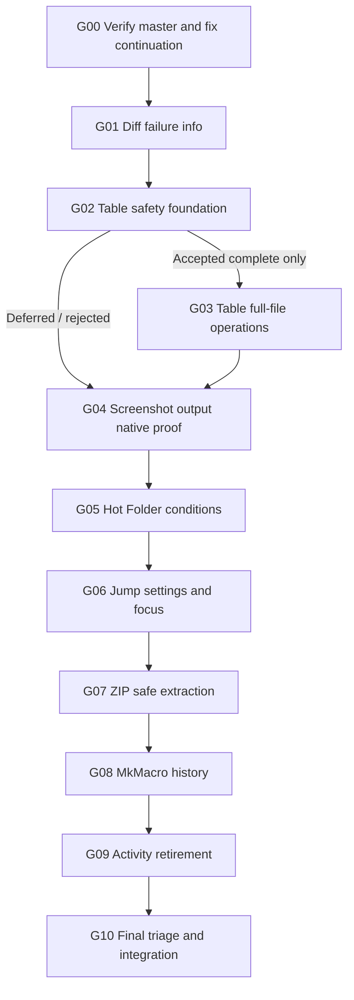

# Initial source evidence and risk map — planning-time, not live execution receipts

**Repository:** `https://github.com/multiplex55/Multi_Launcher`. **Planning-time verified merged master:** `56223fdc123396f4c41c48e0542506d912c6c634`. [PR #1456](https://github.com/multiplex55/Multi_Launcher/pull/1456) and [PR #1457](https://github.com/multiplex55/Multi_Launcher/pull/1457) show merged in GitHub as of 2026-10-29. Do not treat their old dated progress ledgers as ongoing blockers after the merge. Every goal must inspect the real source again before touching it.

| Evidence class | Source / exact owner | Initial interpretation | Workstream |
|---|---|---|---|
| Source-supported defect | [`src/diff/file_ops.rs`](https://github.com/multiplex55/Multi_Launcher/blob/56223fdc123396f4c41c48e0542506d912c6c634/src/diff/file_ops.rs) — `fresh` uses `FileIdentity::read(&dst).ok()` | Treats every destination read error as missing, not only `NotFound`; source error information is lost; runtime damage not reproduced. | G01 |
| Source-supported defect | [`src/gui/diff_dialog/mod.rs`](https://github.com/multiplex55/Multi_Launcher/blob/56223fdc123396f4c41c48e0542506d912c6c634/src/gui/diff_dialog/mod.rs) — `poll_folder_runtime` ignores `report.items`/`cancelled` on Completed | A delivered failed/cancelled/partial report can be discarded during rescan; stale view/root identity requires guarding. | G01 |
| Existing correction | [`src/common/query.rs`](https://github.com/multiplex55/Multi_Launcher/blob/56223fdc123396f4c41c48e0542506d912c6c634/src/common/query.rs) — pending-EOF raw escape only appends decoded value | Former AUD-F001 fixed and merged by #1456; no reimplementation. | G00/G10 no-action |
| Existing guarded partial | [`src/table_utility_session.rs`](https://github.com/multiplex55/Multi_Launcher/blob/56223fdc123396f4c41c48e0542506d912c6c634/src/table_utility_session.rs) — file-backed source/page, export operation IDs/receipts and [`src/gui/table_utility_dialog.rs`](https://github.com/multiplex55/Multi_Launcher/blob/56223fdc123396f4c41c48e0542506d912c6c634/src/gui/table_utility_dialog.rs) | Original G09 M1-A/B accepted; M2 full-file publication and native lifecycle **not** accepted. | G02 → G03 |
| Existing guarded partial | [`src/gui/screenshot_editor.rs`](https://github.com/multiplex55/Multi_Launcher/blob/56223fdc123396f4c41c48e0542506d912c6c634/src/gui/screenshot_editor.rs) — `MarkupLayer::Redaction`, `apply_edits`, crop, Save/Copy | Original G12 layers and UI accepted; native crop/save/copy M2 candidate excluded. | G04 |
| Existing guarded partial | [`src/hotfolder/model.rs`](https://github.com/multiplex55/Multi_Launcher/blob/56223fdc123396f4c41c48e0542506d912c6c634/src/hotfolder/model.rs) — v2 `HotFolderConditions`/fail-closed gate | Conditions modeled but evaluation/UI/Test Rule incomplete. | G05 |
| Existing guarded partial | [`src/gui/jump_mode/config.rs`](https://github.com/multiplex55/Multi_Launcher/blob/56223fdc123396f4c41c48e0542506d912c6c634/src/gui/jump_mode/config.rs) — `JumpModeChord`/alphabet | Typed preferences/controller accepted, editor/native focus remains. | G06 |
| Existing guarded partial | [`src/archive/catalog.rs`](https://github.com/multiplex55/Multi_Launcher/blob/56223fdc123396f4c41c48e0542506d912c6c634/src/archive/catalog.rs) and [`src/archive/plan.rs`](https://github.com/multiplex55/Multi_Launcher/blob/56223fdc123396f4c41c48e0542506d912c6c634/src/archive/plan.rs) | Read-only ZIP catalog and output planner; writer/extraction UI not accepted. | G07 |
| Existing guarded partial | [`src/mkmacro/runtime/summary.rs`](https://github.com/multiplex55/Multi_Launcher/blob/56223fdc123396f4c41c48e0542506d912c6c634/src/mkmacro/runtime/summary.rs) — `SummaryHistory`/metadata-only safe summaries | Bounded run metadata exists, history UI/recipes missing. | G08 |
| Existing guarded partial | [`src/activity.rs`](https://github.com/multiplex55/Multi_Launcher/blob/56223fdc123396f4c41c48e0542506d912c6c634/src/activity.rs) — lifecycle vs retirement and [`src/gui/activity_dialog.rs`](https://github.com/multiplex55/Multi_Launcher/blob/56223fdc123396f4c41c48e0542506d912c6c634/src/gui/activity_dialog.rs) | Activity UI/selected owners accepted, native retire M2-B incomplete. | G09 |
| Existing source/handoff problem | [`docs/plans/continue.md`](https://github.com/multiplex55/Multi_Launcher/blob/56223fdc123396f4c41c48e0542506d912c6c634/docs/plans/continue.md) — old queue branch and resume instruction | Active continuation pointer stale, could start obsolete work. Need verify ownership and correct. | G00 |
| Historical decision only | [Original 17-goal matrix](https://github.com/multiplex55/Multi_Launcher/blob/da898f90b6d83fede9f11f94e32dbeaaef6465c6/docs/plans/execution/multi-launcher-queue-20261025-eedc19d2/INTEGRATION_STATUS.md) | G04/06/09/11/12/14/15/16 partial, 05/07/08/13 deferred, 10/17 skipped. Do not force those historical statuses onto a newer codebase without revalidation. | G10 |
| Historical no-change | [Astra search result](https://github.com/multiplex55/Multi_Launcher/blob/56223fdc123396f4c41c48e0542506d912c6c634/docs/research/multi-launcher-research-20261028-r01/02-search-discovery/RECOMMENDATIONS.md); [admission H0](https://github.com/multiplex55/Multi_Launcher/blob/56223fdc123396f4c41c48e0542506d912c6c634/docs/implementation/SEARCH-F002-discovery-admission-consumer-proof/ADMISSION_DECISION.md) | P2 promising synthetic ranking, but no accepted consumer; no production ranker/UI. | G10 no-action |
| Historical no-change | [AUD-F002 Diff decision](https://github.com/multiplex55/Multi_Launcher/blob/56223fdc123396f4c41c48e0542506d912c6c634/docs/research/diff-mutation-authority-r01/DECISION.md) | Keep best-effort native identity contract; G01 only fixes error-information loss. | G01/G10 scope limit |

## Important unresolved risk ordering

1. **Correctness with concrete current mechanism**: Diff destination error-collapse and missing GUI completion feedback. Prioritize direct fix; no new native mutation framework.
2. **Effectful output with unproven safety**: Table full-file replacement and ZIP extraction. Both require source-/destination-bound publication, quotas, cancellation and refusal semantics **before user UI enablement**.
3. **Native UI/pixel proof**: Screenshot redaction/crop/save/copy and Activity worker lifetime claims; a source/model test cannot replace unsupported OS/input/proof actions.
4. **Unattended rule evaluation**: Hot Folder content DoesNotContain requires complete bounded read and same-lease action authorization; current fail-closed model must remain until implementation proof.
5. **UX/interface closure**: Jump Mode preference UI and MkMacro summary history; preserve hotkey/query focus, privacy and worker ownership.
6. **Historical leftovers and stale instructions**: G00 and G10 reconcile old status with merged master; user-deferred goals are not permission to resume automatically.

## Cross-goal dependency graph

**Interpretation:** the *execution order* is sequential; the only hard logical prerequisite among source goals is G02 accepted → G03. G04–G09 remain independent of G02's success. Each source-effect goal has its own internal native/writer safety gate; failure becomes a documented deferred branch, not a reason to abandon subsequent work.
