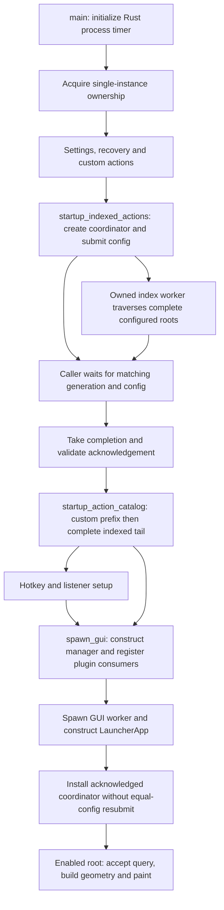

# C3-A readiness and measurement boundaries — LOCAL ONLY

Source inspection base: `d23e57384da453b3e3281e8c09d19630b1d39347`.
Characterization only; startup order is preserved. Measurements are pending.

`main.rs::startup_indexed_actions` waits for the submitted identity, consumes the
retained completion once, propagates scan errors and validates the acknowledged
transfer. Empty roots create no index worker or transfer. `startup_action_catalog`
copies indexed Action bodies into the custom-first catalog; subsequent `Arc`
clones share that catalog. Plugin consumers receive this complete snapshot.
The GUI installs the acknowledged coordinator before later configuration work.
An early frame with a partial plugin catalog would change the contract.

The index worker runs in parallel with the caller's wait. Main/controller and
GUI activity can overlap after GUI spawning. Their durations cannot be added to
produce a critical path merely from log order. Listener creation before plugin
registration does not establish measured native hotkey readiness.

| Evidence domain | Included | Excluded / limitation |
|---|---|---|
| Original binary catalog owner | Actual coordinator construction, submission, complete scan/wait/ack and catalog assembly | Fixture writes, input clones, post-timer oracle and disposal; new coordinator with generally warm OS cache, not process startup or cold disk |
| Supplemental binary attribution | Constant-count actual boundary timings; N indexed-body copies established by source and full output oracle | Worker scan overlaps caller wait; no additive phase-quantile arithmetic |
| Library ready-catalog component | Fresh context, real Omni constructor and nested defaults, apps-only search settings, inert registration, app/transfer, pending query, one real root frame and FullOutput disposal | Complete indexed catalog prepared before timer; generic plugin reload, process loader, hotkeys and native presentation absent |
| Query observer completion | Pending consumption through current-source accepted and painted usable root CPU frame | Earlier context/provider/app construction; nested inside component clock |
| Post-timer proof | Complete real-path Action equality, normalized structure, config/generation/ack, frozen eager geometry and viewport validation | Validation is not prewarming and its elapsed time is not first-frame latency |
| Untimed teardown | App/provider/coordinator drop, joined note reload worker, final native event-handler release | Handler release is not joining notify's detached Windows thread; a failed deadline ends the sample and retains owned paths in the failing process |

The two measured series use different executable boundaries. Their sum is not a
measured process-startup or full-plugin-ready interval. Restricted apps-only
search still uses the real Omni constructor, which initializes non-app providers
and watchers before applying its flags. Global snapshots/caches and the fixed
owned root are warmed across each five-plus-twenty series. This establishes no
first-process cache, allocator/RSS or production prevalence claim.

Existing `Metric::IndexScan` calls count traversal `next_step` invocations, not
coordinator requests. The coordinator's cancellable iterator uses the current
default batch size 512 and performs a final terminal step. The three frozen sizes
therefore expect 2, 3 and 21 calls, respectively, with work 16, 1000 and 10000,
one completed scan and zero errors/abandonments. Its elapsed aggregate is summed
traversal-step time, not one continuous scan wall interval. It overlaps caller
wait and is not additive with that duration.

Historical `startup.first_update` and `startup.first_usable_frame` retain their
original first-observation meanings. C3-A uses separately labelled accepted CPU
completion; it does not redefine the historical metrics. Rust-main timing
excludes loader/process creation. Native process/hotkey/input-to-display evidence
is NOT RUN / NOT MEASURED.

Constructor-search qualification: real LauncherApp::new performs its normal
initial empty-query search while constructing caches/provider state. Preserve
that behavior unchanged and include it in the app-construction/whole component
clock. No-pre-search forbids additional fixture preparation searches; it does
not remove inherent constructor work. Enable/reset observation after construction
and before pending `o list ` publication. Exactly one observed PendingQuery/Search
acceptance/completed first frame is required for that request, not one total search
across constructor plus request. There is still no rendered/font/geometry warmup
before the measured frame. No constructor-skip seam or gui/mod.rs source edit.

Copy-count qualification: `clone_indexed_actions` measures the unchanged
`.iter().cloned()` extension. Exactly N indexed Action body clones follow from
that source loop and the complete catalog oracle; no new intercepted clone counter
is emitted. Original work counters retain their output-cardinality meanings.
