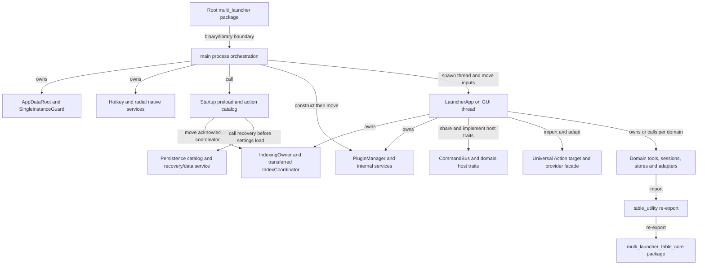
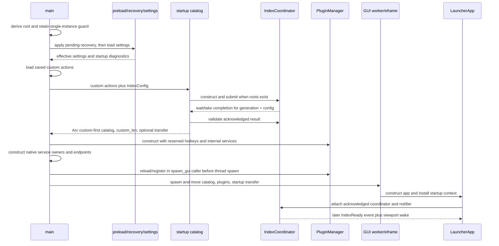
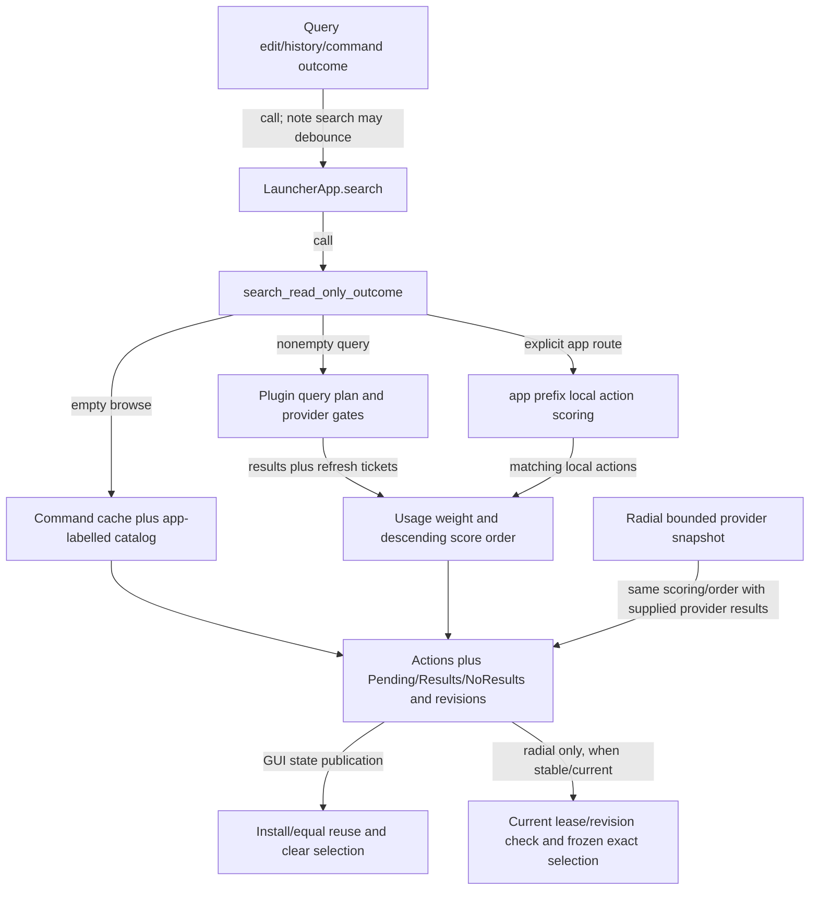

# Architecture and data flows

Checkpoints G01/M1-A and M1-B, 2026-10-28. Source: `59156d96adcc73939c7171487a0cb582e3286587`. The first portion records component/bootstrap/shutdown wiring; the M1-B extension below traces query/activation contracts. [INPUT_AND_UI_OWNERSHIP.md](INPUT_AND_UI_OWNERSHIP.md) covers input transitions. Worker/mutation/save internals remain **pending M2-A**. See [coverage](COVERAGE_MATRIX.md) for achieved depth and [source map](SOURCE_MAP.md) for navigation.

## Edge semantics

An arrow has an explicit meaning:

| Label | What static source establishes | What it does not establish |
|---|---|---|
| `call` | A named caller invokes a function/method in the inspected path | Every runtime branch reaches it, or the callee succeeds |
| `move` | An owned value crosses a constructor/closure boundary | Worker/resource retirement at the later owner |
| `share` / `owns` | An `Arc`/field/local retains a value or service | Exclusive access or current execution authority |
| `message` | A sender/notifier publishes an event/wake | Synchronous handling, native focus or latency |
| `import/re-export` | A module/type/dependency is exposed in source | A call, a worker, an independent crate or a loaded dynamic plugin |

The diagrams do not resolve macros, `cfg`, virtual trait calls or arbitrary DLL implementations. Only the normal-launcher path is drawn; `main` can first serve an internal brightness-helper request. Local eframe/egui patches influence callbacks and must be read before inferring upstream runtime guarantees. [E1], [E2]

## Component and ownership map

This diagram combines explicitly labeled package and runtime-owner relations; an edge from `Domains` does not mean every domain uses table processing. The root workspace has the application and table core; the cursor-effects smoke tool has a separate manifest/workspace. The table facade is an existing extraction, while most other feature directories remain modules of the application crate. [E2], [E3], [E4]

`LauncherApp` has action/catalog/cache/query/result/selection state, the plugin manager, command bus, index owner, activity center and domain/dialog services. `main` retains its own hotkey/radial/reconfiguration/native-preview owners. Both have explicit exit responsibilities; neither one struct nor one hypothetical global coordinator owns every task. [E5], [E6]

## Normal startup: value and authority transfer

The no-index-roots branch skips coordinator creation and returns an empty indexed tail. For nonempty roots, startup checks both completion identity fields before and after `take_result`, then validates acknowledgment. A startup error propagates through `startup_action_catalog`/`main`; this diagram's successful transfer is not assumed on failure. `custom_len` remains the boundary between saved custom actions and indexed tail. [E7]

`spawn_gui` performs provider registration before entering `GuiWorker::spawn`; consequently the name alone does not locate all of its work on the GUI thread. It then moves the registered manager into the eframe app creator. The creator installs the original startup coordinator, not a newly created replacement for the acknowledged initial result. A failed GUI installation is reported as `index.startup`. [E8]

| Transition | Accepted state / owner | Rejection or failure represented by inspected source |
|---|---|---|
| Normal process admission | `main` retains `SingleInstanceGuard` after acquisition | `AlreadyRunning` returns; acquisition failures propagate. This is source wiring, not a native mutex experiment. [E1] |
| Recovery/settings preload | Recovery result and effective settings are returned together | Malformed settings retain diagnostic + temporary defaults. Failed migration save returns original effective settings with diagnostic. [E9] |
| Initial indexing | Exact generation/config result acknowledged before transfer | Empty roots skip work; construction/submit/wait/result/validation/outcome errors propagate. [E7] |
| Catalog publication to consumers | Custom-first `Arc<Vec<Action>>` and exact `custom_len` passed to both registration/app creation | Detailed later mutation/publication of catalog remains M1-B/M2-A. [E7], [E8] |
| GUI startup index install | App's `IndexingOwner` receives coordinator/config/generation and notifier | Rejects closed owner, existing coordinator or mismatched desired config; checks acknowledged result before attachment. [E10] |
| Domain service construction | App owns distinct runtime/dialog fields; shared catalogs are supplied through PluginManager services | Production initialization has explicit isolated-test alternatives. This does not mean a normal constructor is side-effect free. [E5], [E11] |

## Shared domain boundaries

The command model is already typed: `CommandInvocation` holds `Command`, original `Action`, query override and `ActivationSource`; the bus explicitly dispatches domain variants through `CommandHost`. `LauncherApp` implements the host traits and invokes the bus before applying an outcome. This establishes a stable reuse seam. It does **not** yet prove every activation route enters it with identical confirmation or eligibility rules. That is the M1-B trace. [E12], [E13], [E24]

`PluginManager` owns `Arc<PluginSlot>` entries and internal clipboard-modifier, macro, window and workspace catalogs. `PluginSearchSnapshot` clones provider ownership plus enablement/capability inputs and shares search updates. The Plugin trait separately exposes query prefixes, capabilities and `PluginQueryPolicy`; provider lookup and actual dynamic DLL implementation remain distinct. Snapshots can outlive a mutable GUI borrow, so future reasoning must follow current-result/revision/admission checks rather than infer current authority from retained ownership. This is an architectural constraint, not a finding of stale execution. [E14], [E22]

Universal Actions has a separate target/resolver/provider/registry/operation facade and GUI catalog/executor adapters. Its surface/context/availability concepts coexist with command activation source. M1-A records these owners; execution, saved-target resolution and confirmation parity are pending. [E15]

Persistence combines domain stores with a canonical store catalog, backup/recovery and a data-service owner. `AppDataRoot` records the settings-directory identity without relocating existing relative persistence paths. `PersistenceCatalog` carries typed store metadata, privacy/ownership/backup/recovery fields and explicitly invoked probes; normal construction can discover configured paths. `DataService` wraps state, wake sender and a named worker. A central catalog is not evidence that all stores have one schema or one transaction. [E16], [E17], [E23]

## Separate message planes

| Plane | Producer / consumer relationship | Evidence and current limit |
|---|---|---|
| Main `Sender<()>` wake channel | Native/service callbacks and GUI worker completion wake the main loop | `GuiWorker::wait_for_event` distinguishes wake, completed flag and channel closure. A unit wake carries no action payload by itself. [E6], [E18] |
| GUI `EventSender` / `WatchEvent` channel | App registers an event sink; callbacks send typed events and request viewport repaint | App construction/dashboard callback and index notifier read. Full dispatch/coalescing/error behavior pending. [E10], [E11] |
| Shared snapshots/revisions | `Arc<Vec<Action>>`, plugin slots, revision atomics and catalogs are shared across owners | These are data/identity carriers, not interchangeable with event delivery. Consistency and lease enforcement need the later flow traces. [E5], [E8], [E14] |
| Registry/service client endpoints | GUI clients refer to main-owned radial authoring/control services; settings-save registry is shared across process/GUI owners | Main constructs and passes them explicitly. Full admission, worker completion and teardown semantics pending M2-A. [E6], [E8] |

## Exit paths and the limit of call ordering

| Exit path | Inspected sequence | What remains to prove later |
|---|---|---|
| GUI callback `on_exit` | Invalidate Paste owner; disable Hot Folder adapter/pump; shut down Hot Folder/dialog/session/capture/index/tool owners; clear bridges; cancel prompts; shut down multi-manager; unregister hotkeys; prepare settings-save shutdown; flush usage through target repair/fallback | Follow each callee's cancellation, terminal publication, join/resource cleanup and error path. An `on_exit` call is not a blanket guarantee of completion. [E19] |
| GUI completed or wake channel closed | Begin settings-save shutdown; remove runtime receiver; request invocation lifecycle cancellation; radial/native-preview/resource shutdown; stop invocation service/listener; join GUI; join save workers; return | Native service stop guarantees, blocked wait possibilities and already-closing resource interactions remain M2-A. [E20] |
| Quit hotkey | Request invocation shutdown; stop radial/native resources and listener; begin settings-save shutdown; remove receiver; ask root viewport to close/repaint; join GUI; join save workers | This order differs from GUI-completed path because a still-running GUI must first be closed. No native exit scenario was run. [E21] |

The current code provides explicit shutdown surfaces and a process-lifetime guard worth preserving. M2-A will distinguish completion rejection, cancellation, actual join and resource retirement by owner. This checkpoint accepts no new follow-on recommendation and makes no latency, memory, deadlock-absence or focus guarantee.

## Pinned evidence

[E1]: https://github.com/multiplex55/Multi_Launcher/blob/59156d96adcc73939c7171487a0cb582e3286587/src/main.rs#L4225-L4246
[E2]: https://github.com/multiplex55/Multi_Launcher/blob/59156d96adcc73939c7171487a0cb582e3286587/Cargo.toml#L289-L300
[E3]: https://github.com/multiplex55/Multi_Launcher/blob/59156d96adcc73939c7171487a0cb582e3286587/src/table_utility.rs#L1-L7
[E4]: https://github.com/multiplex55/Multi_Launcher/blob/59156d96adcc73939c7171487a0cb582e3286587/tools/cursor_effects_smoke/Cargo.toml#L1-L17
[E5]: https://github.com/multiplex55/Multi_Launcher/blob/59156d96adcc73939c7171487a0cb582e3286587/src/gui/mod.rs#L954-L1054
[E6]: https://github.com/multiplex55/Multi_Launcher/blob/59156d96adcc73939c7171487a0cb582e3286587/src/main.rs#L4332-L4611
[E7]: https://github.com/multiplex55/Multi_Launcher/blob/59156d96adcc73939c7171487a0cb582e3286587/src/startup_catalog.rs#L7-L125
[E8]: https://github.com/multiplex55/Multi_Launcher/blob/59156d96adcc73939c7171487a0cb582e3286587/src/main.rs#L4037-L4212
[E9]: https://github.com/multiplex55/Multi_Launcher/blob/59156d96adcc73939c7171487a0cb582e3286587/src/startup.rs#L22-L86
[E10]: https://github.com/multiplex55/Multi_Launcher/blob/59156d96adcc73939c7171487a0cb582e3286587/src/gui/indexing.rs#L11-L139
[E11]: https://github.com/multiplex55/Multi_Launcher/blob/59156d96adcc73939c7171487a0cb582e3286587/src/gui/mod.rs#L3061-L3164
[E12]: https://github.com/multiplex55/Multi_Launcher/blob/59156d96adcc73939c7171487a0cb582e3286587/src/commands/model.rs#L13-L104
[E13]: https://github.com/multiplex55/Multi_Launcher/blob/59156d96adcc73939c7171487a0cb582e3286587/src/gui/command_host.rs#L2143-L2213
[E14]: https://github.com/multiplex55/Multi_Launcher/blob/59156d96adcc73939c7171487a0cb582e3286587/src/plugin.rs#L339-L768
[E15]: https://github.com/multiplex55/Multi_Launcher/blob/59156d96adcc73939c7171487a0cb582e3286587/src/universal_actions/mod.rs#L6-L29
[E16]: https://github.com/multiplex55/Multi_Launcher/blob/59156d96adcc73939c7171487a0cb582e3286587/src/platform/app_data.rs#L5-L60
[E17]: https://github.com/multiplex55/Multi_Launcher/blob/59156d96adcc73939c7171487a0cb582e3286587/src/persistence/catalog.rs#L186-L265
[E18]: https://github.com/multiplex55/Multi_Launcher/blob/59156d96adcc73939c7171487a0cb582e3286587/src/main.rs#L3960-L4013
[E19]: https://github.com/multiplex55/Multi_Launcher/blob/59156d96adcc73939c7171487a0cb582e3286587/src/gui/render.rs#L10043-L10125
[E20]: https://github.com/multiplex55/Multi_Launcher/blob/59156d96adcc73939c7171487a0cb582e3286587/src/main.rs#L4643-L4667
[E21]: https://github.com/multiplex55/Multi_Launcher/blob/59156d96adcc73939c7171487a0cb582e3286587/src/main.rs#L6228-L6253
[E22]: https://github.com/multiplex55/Multi_Launcher/blob/59156d96adcc73939c7171487a0cb582e3286587/src/plugin.rs#L104-L158
[E23]: https://github.com/multiplex55/Multi_Launcher/blob/59156d96adcc73939c7171487a0cb582e3286587/src/persistence/data_service.rs#L249-L309
[E24]: https://github.com/multiplex55/Multi_Launcher/blob/59156d96adcc73939c7171487a0cb582e3286587/src/commands/bus.rs#L14-L100

## M1-B — Query routing, ranking and activation

This extension is a static deep trace of shared query/activation paths and representative alternate surfaces, not all provider algorithms. Test bodies are evidence of intended contracts; none were run. The [provisional finding index](FINDINGS.md) distinguishes the accepted raw-token concern from unaccepted policy questions.

### Query intake and dispatch

Text changes call search immediately except the explicit note-search debounce. Query-history replacement clears selection/suggestions, routes through the same text-change behavior, and requests query focus. Command outcomes can set a query or replace results and optionally request search; these are separate transitions rather than string substitution inside every handler. [QB1], [AB7]

| Query form / boundary | Actual source behavior | Compatibility consequence |
|---|---|---|
| Empty/whitespace browse | Returns command cache, then catalog Actions with displayed label `app <label>` and original action/args. No provider query is needed for this branch. | Browse order is not the nonempty ranking algorithm; preserve original payload independently of display prefix. [QB2] |
| `app` or `app ` prefix | Recognized case-insensitively from trimmed query; tail passes through shared action filters into local catalog scoring. Providers still follow their own routing rules. | General unprefixed text is not automatically a full local-app search. [QB3] |
| `g ` prefix | Normal and snapshot routes substitute a provider set containing only `web_search`; capability settings still pass through. This special set replaces the ordinary enabled-plugin set. | Do not claim every query respects the ordinary enablement list identically. Existing parity test explicitly includes an empty enabled list. This is a preserved source contract, not a newly classified bug. [QB4], [QB5] |
| Ordinary provider query | Parse `kind:`/`id:` filters, compute per-provider plan, then test enabled plugins, search capability and prefix/global/always-search policy. | Empty prefix list and `always_search` remain real provider behaviors; a new discovery layer must not infer all providers are prefix-only. [QB6] |
| Matching-prefix Literal provider | Uses original query only when the original head matches that provider's declared prefix. Skips action-filter application for that provider. | QR payload can include repeated spaces, quotes, newlines and filter-looking literal data. Merely declaring Literal does not make unrelated query heads literal. [QB6], [QB7] |
| Empty provider-return vector, non-`g` route | For a non-`g` query, an empty provider-return vector enters command-cache fallback under the current exact/fuzzy rules. The explicit `g ` branch returns without that fallback. A nonempty provider vector that becomes empty during exact post-filtering does not trigger another fallback pass. | Cache construction respects enabled plugins and lowercase label order. [QB8] |
| Provider capacity occupied | For a nonempty query, skips provider execution and command-cache fallback. Assembly receives no scored provider rows; eligible local `app` rows can remain, while other routes are row-empty. Result retains `Capacity` and `Pending`; empty browse is handled earlier. | Capacity release refreshes current query only. Failed-provider reopening explicitly invokes the provider-result scorer and is a different path. [QB2], [QB10], [review evidence](roles/reviewer/REVIEW.md#review-01--medium-the-search-handoff-overgeneralizes-command-fallback) |

`RawToken.value` is used for filter classification while remaining `raw` spellings reconstruct provider/local text. This deliberately distinguishes decoded grammar from literal transport spelling. [AUD-001](findings/AUD-001-terminal-query-escape.md) documents the EOF pending-escape inconsistency without expanding it into every path or Literal provider. [QB6], [QB7]

### Existing scoring and result installation

The existing score is not a learned/discovery model. Let `F` be `fuzzy_weight`, `U` be `usage_weight`, and `n(a)` be usage count indexed by `Action.action` (args and label are not part of that key). Every assembled scored entry adds `n(a) × U`, then uses descending floating comparison. The comparator has no additional explicit semantic tie key. This is code behavior, not a measured relevance result. [QB3], [QB8], [QB9]

| Candidate class | Base score / inclusion |
|---|---|
| Local `app` tail with no remaining text | All actions passing metadata filters, base zero. |
| Local exact mode (`match_exact` or `F <= 0`) | Include case-folded displayed label, description, action string or alias matches. Alias match scores one, otherwise zero. |
| Local fuzzy mode | Include only when label or description has a fuzzy match; use the maximum score times `F`. |
| Returned provider Actions in fuzzy mode | Score maximum label/description fuzzy score against raw query, using zero when unmatched; returned resolved output is retained. This differs intentionally in mechanism from local hit admission. |
| Returned provider Actions in exact mode | Tail/display/action/alias filtering, with explicit resolved-output exemptions for QR, selected note commands, Clipboard Modify and date outputs. Query suggestions are excluded from the bypass. |
| Command-cache fallback | Exact metadata/alias or successful label/description fuzzy match only for a non-`g` route with an empty input provider vector; no retry after exact filtering empties a nonempty vector, and no command fallback during capacity deferral. |

The exact post-filter exemptions prevent computed/resolved results from disappearing merely because their visible text does not contain an expression or full command. A replacement ranking proposal must first preserve this behavior or explicitly authorize a migration. The representative exact-match and ranking tests document computed date outputs and fuzzy-versus-usage precedence; they were inspected, not passed. [QB8], [QB11]

`search` records pending/provider revision/result-catalog versions separately from rows. It clears `selected` on the cached return, equal-result reuse and replacement paths. Equal same-query results can retain the vector/geometry and clean up popup state, but that does not preserve active row selection. Nonempty installation records last raw query; cache-valid state is controlled by provider deferral, not synonymous with `Pending == false`. Note autocomplete uses a separate FST suggestion index, rebuild debounce and five-suggestion limit, disabled for empty query/dashboard. [QB10], [QB12]

### Refresh, replacement and cancellation

`PluginSearchUpdates` has per-source active/published/resolved-through tickets and global/source generations. `schedule_or_join` joins an active ticket; publication commits only the currently active ticket; follow-up reservation can occur under the same lock. Cancellation resolves only the matching active ticket and notifies. Notification increments generation and invokes repaint outside the ticket mutation. A ticket being resolved is publication/admission state, not worker resource retirement. [QB13]

The ordinary frame sees provider generation change, invalidates the cached search and searches current query unless OCR defers refresh. Deferred background refresh is a flag; search always uses `self.query`. `resume_capacity_deferred_search` additionally requires a still-invalid cache and equality with the current last-search query; it never installs the released worker's captured text. [QB10], [QB14]

For a concrete adverse sequence, query A begins provider work, user edits B, then A publishes. The ordinary owner refreshes B from its current field; it does not restore A. Radial deferred work is separately rejected when cancelled or preparation/config identity is no longer current; it returns Pending for changing provider/catalog revisions, and only freezes a selected exact Action when its snapshot is stable/current. Dispatch and confirmation check again. These counterguards prevent treating “async exists” as a demonstrated stale-execution defect. Native scheduling/resource release still needs M2-A. [QB13], [RB1], [RB2]

### Cross-surface authority

| Surface/route | Entry → validation → execution | Deliberate differences and limits |
|---|---|---|
| Enter from results | Focus/dialog/first-pass gates → `handle_key` → clone exact current Action via `deferred_activation_from_results` → `activate_action` → parse → destructive confirmation → bus/host/outcome | `selected` is a presentation index, but deferred activation owns a cloned Action and args; it does not later fetch a changed list index. [AB1], [AB2], [AB12] |
| Mouse result | Current rendered Action → `DeferredActivation { source: Click }` → same normal activation | Payload is carried directly; list/context/menu and authoring-add flows are distinct. [AB13] |
| Dashboard click | `WidgetAction { action, query_override }` → `activate_action(..., Dashboard)` | Widgets often supply visible label as query override. Dispatcher applies it only when `command_accepts_query_override`; QR and several structured/tool domains opt out. Override does not replace their typed payload. [AB3], [AB4] |
| Gesture | Service emits `WatchEvent::ExecuteAction`; GUI handles it with source `Gesture` → normal activation | Native gesture recognition/preparation is a separate owner. This trace proves its GUI activation seam, not all hook/focus behavior. [AB5] |
| MkMacro launcher command | Resolved legacy Action uses source `Macro`; query request runs current search, returns NoResults / activates one row / presents many rows for selection | Response `Activated` means activation was requested, including a possible confirmation; it is not a completed side-effect receipt. This branch selects by row count rather than checking pending status. Whether it should require stable provider results remains an unaccepted M2-B contract question. [AB6] |
| Action sheet/context secondary | Captures available UniversalAction with source; executor checks the passed action's availability and safety, then dispatches operation | Surface and activation source remain distinct. Secondary outcomes are normalized; they do not inherit every primary query/history/visibility side effect. [UB1], [UB2] |
| Radial | Current preparation/dispatch identity and duplicate tombstones → current query/catalog revisions → fresh target resolution and interaction-requirement agreement → UniversalAction context | Stable saved reference/context/history/root policy retained. Ordinary root state is preserved unless explicit root/UI/exclusive-capture policy requires legacy behavior. Destructive radial safety can require confirmation independently of the ordinary setting. [RB2], [UB1] |
| Paste Sequence hotkey | Dedicated `Start(id)` calls `run_paste_sequence(..., Hotkey)`; Next acts only in AwaitAdvance; Cancel cancels active playback | This is a typed domain control route, not an arbitrary query-to-first-result route. Admission/physical-input lease details belong to M2-A. [AB8] |
| Unattended Hot Folder registered action | Resolve unique persisted target → verify binding/fingerprint → fresh RESULT_EXECUTE availability/operation → require supported External process target/no namespace → bus with source HotFolder | Direct bus invocation is protected by a restricted unattended eligibility contract. Unsupported UI/command/ambiguous/changed targets fail; bypassing normal interactive confirmation here does not authorize arbitrary destructive commands. Full external-enable/file evidence is M2-A. [HB1] |
| Legacy/headless facade | `launcher::launch_action` → canonical `parse_action` → `commands::headless::execute` | Shares parser, not every GUI service. Many GUI-only domains explicitly reject; selected legacy compatibility forms retain external fallback. Do not replace that with an invented universally identical bus path. [AB9], [AB14] |

Normal activation preserves original Action/query override/source in `CommandInvocation`, reports parse errors, stores exact invocation on destructive confirmation and dispatches it only after approval. Cancel consumes pending confirmation without dispatch. It does not contain a universal provider-provenance re-resolution step; search admission and domain execution policies are separate boundaries. Universal execution first checks the **passed** availability; radial additionally resolves current target state. These are source facts, not a conclusion that every stale nonradial action is executable or that a new global guard is required. [AB2], [UB1]

A separate compatibility macro-query adapter, `poll_macro_launcher_query`, also remains in source: it installs the requested query, searches, activates the first row using source Enter and returns an empty-result error otherwise. It must not be described as identical to the newer command broker's zero/one/many behavior or source Macro. This checkpoint records the adapter; caller migration/product-policy decisions remain unaccepted pending M2-B. [AB15]

Radial dispatch marks a current identity consumed with bounded tombstones, rejects old/duplicate leases, verifies query versions before dispatch and resolves exact current target/action. Confirmation repeats lease/version/resolution checks; expired selection may open the saved query rather than execute. When after-action policy keeps the tree open, fallback reports instead of opening over it. Failure fallback suppresses the already-failed provider for that reopening, preventing synchronous reentry. [RB1], [RB2], [RB3], [RB4], [UB1]

Outcomes separately control query, pending query, result replacement/search, visibility, focus, toast and history. Radial primary dispatch supplies captured history query/root policy; secondary dispatch normalizes primary effects. `HistoryPolicy::Record` records original Action, query and source; usage delta is keyed by action string. Data-retention/privacy safety of those stores is still M2-A. A radial-only nested `queryexec` guard preserves the ordinary launcher's legacy recursion behavior; this is another reason not to claim route equivalence from a common enum. [AB7], [UB2], [AB10]

### Dashboard query contract assessment

`PluginHomeWidget` chooses a provider and Commands/Search mode. Its search helper calls `split_action_filters`, sends trimmed remaining text directly to `Plugin::search`, then applies action filters. Cache identity contains plugin/mode/query/generation/plugin epoch/config epoch. `PinnedQueryResultsWidget` rejects empty query/disabled selected engine, splits filters, calls `search_plugin_with_ticket` for that named engine, filters/truncates results, and explicitly distinguishes RunAction from FillQuery. Neither direct-call path uses manager `plugin_query_plan`. [DB1], [DB2]

That yields a concrete semantic difference for a Literal provider: launcher/snapshot `qr kind:qr` preserves `kind:qr` as payload, while these widget helpers remove it as a result filter before calling QR. QR's payload is the exact string after its prefix. The difference is established by source composition, not an executed UI reproduction. Widget filtering is itself explicit code and may be an intentional widget-specific query language; the selected engine also makes routing different from general launcher input. [DB1], [DB2], [QB7]

**Disposition at M1-B: unaccepted contract candidate for M2-B, no new production recommendation.** The remaining decision is whether dashboard query fields promise launcher-Literal parity or an independent filter grammar, including persisted query migration. No evidence here authorizes silently changing those saved widget semantics. If selected later, use one policy/migration package for the actual shared owner rather than separate duplicate fixes per widget. Plugin Home enablement/capability behavior and widget loader retirement are not certified by the narrow query-policy read; later audit can target them if their contract warrants it.

### Current evidence and minimum remaining proof

Read source and representative contracts in `tests/plugin_routing.rs`, `tests/plugin_exact_match.rs`, `tests/domain_cases/{command_bus_architecture,ranking,selection}.rs`, QR/snapshot and Universal Action parity tests. No test result follows from their existence. Existing safeguards support NO_ACTION for a replacement bus/shared search framework. The raw-token correction remains the sole accepted actionable recommendation at this checkpoint; dashboard semantics and macro pending-result admission remain explicitly unaccepted questions for M2-B. [QB5], [QB11], [AB11]

[QB1]: https://github.com/multiplex55/Multi_Launcher/blob/59156d96adcc73939c7171487a0cb582e3286587/src/gui/render.rs#L1739-L1794
[QB2]: https://github.com/multiplex55/Multi_Launcher/blob/59156d96adcc73939c7171487a0cb582e3286587/src/gui/search.rs#L1395-L1498
[QB3]: https://github.com/multiplex55/Multi_Launcher/blob/59156d96adcc73939c7171487a0cb582e3286587/src/gui/search.rs#L989-L1089
[QB4]: https://github.com/multiplex55/Multi_Launcher/blob/59156d96adcc73939c7171487a0cb582e3286587/src/gui/search.rs#L1125-L1148
[QB5]: https://github.com/multiplex55/Multi_Launcher/blob/59156d96adcc73939c7171487a0cb582e3286587/src/gui/search.rs#L3910-L3948
[QB6]: https://github.com/multiplex55/Multi_Launcher/blob/59156d96adcc73939c7171487a0cb582e3286587/src/plugin.rs#L1331-L1437
[QB7]: https://github.com/multiplex55/Multi_Launcher/blob/59156d96adcc73939c7171487a0cb582e3286587/src/plugins/qr.rs#L6-L68
[QB8]: https://github.com/multiplex55/Multi_Launcher/blob/59156d96adcc73939c7171487a0cb582e3286587/src/gui/search.rs#L1125-L1392
[QB9]: https://github.com/multiplex55/Multi_Launcher/blob/59156d96adcc73939c7171487a0cb582e3286587/src/gui/search.rs#L1579-L1675
[QB10]: https://github.com/multiplex55/Multi_Launcher/blob/59156d96adcc73939c7171487a0cb582e3286587/src/gui/search.rs#L802-L985
[QB11]: https://github.com/multiplex55/Multi_Launcher/blob/59156d96adcc73939c7171487a0cb582e3286587/tests/domain_cases/ranking.rs#L31-L82
[QB12]: https://github.com/multiplex55/Multi_Launcher/blob/59156d96adcc73939c7171487a0cb582e3286587/src/gui/search.rs#L707-L799
[QB13]: https://github.com/multiplex55/Multi_Launcher/blob/59156d96adcc73939c7171487a0cb582e3286587/src/plugin.rs#L205-L336
[QB14]: https://github.com/multiplex55/Multi_Launcher/blob/59156d96adcc73939c7171487a0cb582e3286587/src/gui/render.rs#L3875-L3882
[AB1]: https://github.com/multiplex55/Multi_Launcher/blob/59156d96adcc73939c7171487a0cb582e3286587/src/gui/render.rs#L7295-L7326
[AB2]: https://github.com/multiplex55/Multi_Launcher/blob/59156d96adcc73939c7171487a0cb582e3286587/src/gui/actions.rs#L69-L187
[AB3]: https://github.com/multiplex55/Multi_Launcher/blob/59156d96adcc73939c7171487a0cb582e3286587/src/gui/render.rs#L7484-L7495
[AB4]: https://github.com/multiplex55/Multi_Launcher/blob/59156d96adcc73939c7171487a0cb582e3286587/src/gui/command_host.rs#L1611-L1629
[AB5]: https://github.com/multiplex55/Multi_Launcher/blob/59156d96adcc73939c7171487a0cb582e3286587/src/gui/watch.rs#L709-L711
[AB6]: https://github.com/multiplex55/Multi_Launcher/blob/59156d96adcc73939c7171487a0cb582e3286587/src/gui/render.rs#L3098-L3138
[AB7]: https://github.com/multiplex55/Multi_Launcher/blob/59156d96adcc73939c7171487a0cb582e3286587/src/gui/command_host.rs#L2238-L2425
[AB8]: https://github.com/multiplex55/Multi_Launcher/blob/59156d96adcc73939c7171487a0cb582e3286587/src/gui/command_host.rs#L578-L610
[AB9]: https://github.com/multiplex55/Multi_Launcher/blob/59156d96adcc73939c7171487a0cb582e3286587/src/commands/headless.rs#L352-L449
[AB10]: https://github.com/multiplex55/Multi_Launcher/blob/59156d96adcc73939c7171487a0cb582e3286587/src/gui/actions.rs#L315-L354
[AB11]: https://github.com/multiplex55/Multi_Launcher/blob/59156d96adcc73939c7171487a0cb582e3286587/src/gui/universal_action_executor.rs#L1494-L1523
[AB12]: https://github.com/multiplex55/Multi_Launcher/blob/59156d96adcc73939c7171487a0cb582e3286587/src/gui/render.rs#L1296-L1312
[AB13]: https://github.com/multiplex55/Multi_Launcher/blob/59156d96adcc73939c7171487a0cb582e3286587/src/gui/render.rs#L7708-L7721
[AB14]: https://github.com/multiplex55/Multi_Launcher/blob/59156d96adcc73939c7171487a0cb582e3286587/src/launcher/exec.rs#L1-L11
[AB15]: https://github.com/multiplex55/Multi_Launcher/blob/59156d96adcc73939c7171487a0cb582e3286587/src/gui/render.rs#L3147-L3190
[UB1]: https://github.com/multiplex55/Multi_Launcher/blob/59156d96adcc73939c7171487a0cb582e3286587/src/gui/universal_action_executor.rs#L84-L240
[UB2]: https://github.com/multiplex55/Multi_Launcher/blob/59156d96adcc73939c7171487a0cb582e3286587/src/gui/universal_action_executor.rs#L432-L551
[RB1]: https://github.com/multiplex55/Multi_Launcher/blob/59156d96adcc73939c7171487a0cb582e3286587/src/gui/radial_actions.rs#L1715-L1789
[RB2]: https://github.com/multiplex55/Multi_Launcher/blob/59156d96adcc73939c7171487a0cb582e3286587/src/gui/radial_actions.rs#L2058-L2298
[RB3]: https://github.com/multiplex55/Multi_Launcher/blob/59156d96adcc73939c7171487a0cb582e3286587/src/gui/radial_actions.rs#L1847-L1858
[RB4]: https://github.com/multiplex55/Multi_Launcher/blob/59156d96adcc73939c7171487a0cb582e3286587/src/gui/radial_actions.rs#L2477-L2536
[DB1]: https://github.com/multiplex55/Multi_Launcher/blob/59156d96adcc73939c7171487a0cb582e3286587/src/dashboard/widgets/plugin_home.rs#L12-L108
[DB2]: https://github.com/multiplex55/Multi_Launcher/blob/59156d96adcc73939c7171487a0cb582e3286587/src/dashboard/widgets/pinned_query_results.rs#L374-L428
[HB1]: https://github.com/multiplex55/Multi_Launcher/blob/59156d96adcc73939c7171487a0cb582e3286587/src/gui/hotfolder_dispatch.rs#L479-L592
