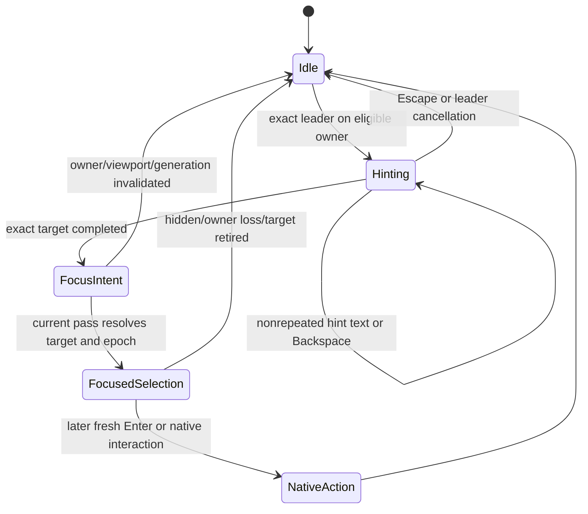

# Input and UI ownership — M1-B

Source: `59156d96adcc73939c7171487a0cb582e3286587`; 2026-10-28. Static deep trace of shared root/Jump/activation guards and targeted representative dialog/viewport transitions. This does not certify every rendered control or actual Windows foreground timing. [Coverage](COVERAGE_MATRIX.md) records those limits. No GUI/native scenario was run.

## Existing owners and authority boundaries

`LauncherApp` holds root query/results/selection and domain dialog state. Main/native services own their own invocation and hotkey state; typed events/clients cross into GUI ownership. The inspected UI layer has three separate responsibilities:

| Responsibility | Actual owner and source contract |
|---|---|
| Root query focus and visibility | `render.rs` tracks pending show-query focus and a query-focus session against visibility revision and root window identity. Hidden/revised visibility invalidates those grants. Root query focus is additionally blocked by modal/popup/capture/prompt/tool/foreign-layer ownership. [I1], [I2] |
| Navigation target identity and hint matching | `jump_mode.rs::TargetId` binds surface + semantic target + generation; `HintSession` owns matching/lifecycle. Labels are presentation metadata, not target identity. [I3] |
| UI eligibility and handoff | `jump_mode/ui.rs::JumpModeUi` owns per-frame owner, registry, epoch, focus intent, captured key/release fences and exact viewport binding. Owners/registering controls resolve the intent. [I4], [I5] |

The root query and a supported dialog are not simultaneously eligible merely because both are visible. `resolve_layer_navigation_owner_parent` checks ROOT, viewport focus and no modal, then recognizes the actual top middle layer and associated current dialog instance. Unknown foreground layers, mismatched focused middle layers, stale open-window state or unrecognized popup ownership resolve to Blocked. A recognized combo popup must match its parent/anchor/viewport; it is not a blanket exemption for all popups. [I6]

The app candidate resolver records supported dialog visibility/instances; gives snippet prompt its exact native owner/generation when supported; recognizes selected confirmation children; and blocks unsupported nested note/MkMacro owners. Batch Rename/Search Replace parent planning targets are absent when operation/confirmation/recovery child state takes authority. Pending children can block parent hints before the child first becomes visible. This is a targeted shared-owner trace, not proof of every child renderer. [I7]

## Transition table

| State / transition | Eligible owner and effect | Guard / evidence / remaining limit |
|---|---|---|
| Root hidden or becomes hidden | Jump transient state is cancelled; hidden logic still runs background owner work | `begin_root_frame_logic`/`run_hidden_logic_tick` call `cancel_all`; visibility revision invalidates query-focus grants. Hidden UI is not worker retirement. [I1], [I8] |
| Root shown by explicit activation | Pending show-query request is bound to current visibility revision/root identity; actual query focus still needs eligible owner | File Search, modal/action sheet/prompts/capture/tool/editor/foreign layer can block focus. A visibility flag alone is insufficient. Native activation success remains unverified. [I1], [I2] |
| Ordinary text typing | Query TextEdit owns native keyboard flow; unhandled non-Jump events remain available | Root shortcuts require query focus; note-search changes debounce, history traversal replaces query through shared search and focus request. [I9] |
| Dashboard visible | Dashboard click returns a concrete WidgetAction and routes with source Dashboard | Keyboard/input ownership is still the root/frame/dialog contract; widget result computation is not permission to execute. [I10] |
| Action sheet opens | Sheet owns navigation keys; Ctrl+Enter opening is consumed, unmodified Enter can select an available action | Sheet filters capture exact UniversalAction; disabled-only rows can remain visible but cannot produce an invocation. Ctrl+Enter while open is eaten without execution. [I11] |
| Confirmation modal | Root query/Jump host blocked; approval consumes pending command or UniversalAction context; cancel does not dispatch | Radial confirmation additionally rechecks lease/query versions/current resolution. Ordinary pending-command confirmation retains its invocation. Do not infer identical revalidation for all sources. [I2], [I12] |
| Supported ROOT dialog becomes foreground | Exact dialog instance/layer receives supported targets; query may surrender focus | Owner or popup change cancels old registry/focus/session, advances epoch, and blocks the transition frame. Unsupported nested owner returns Blocked. [I6], [I7], [I13] |
| Unknown popup/window picker | Block navigation and retire old hints; keep normal picker interaction | Actual mouse-gesture window-picker test seeds the real picker state and expects Blocked/empty registry. OS file dialogs are a separate native surface whose focus sequence was not executed here. [I6], [I14] |
| External application foreground / viewport loses focus | Native host/viewport admission fails; session keys/owner state are quarantined or cancelled | Guards use egui focus/viewport plus app input-owner state. Actual Windows foreground/focus propagation timing remains a future native proof requirement for any changed behavior. [I4], [I15] |
| Supported child viewport | A separate `NavigationViewportBinding` names exact non-ROOT viewport, owner and base layer | Supported owner whitelist, viewport focus, no top modal and expected visible layer required. Wrong context quarantines that coordinator without surrendering another viewport's focus. [I4], [I5] |
| Capture or input-exclusive tool begins | Root/query host blocked according to capture/prompt/tool ownership; normal native owner retains control | Macro/parameter/snippet prompt, active Screen Draw/toolbar, coordinate capture and gesture capture are explicit blockers; pin/color/OCR parking adds query-specific guards. No synthetic focus workaround is proposed. [I2], [I15] |
| Dialog closes/reopens or result population changes | New instance/generation/owner invalidates old navigation authority | Exact owner updates cancel old state; current registry reconciliation compares target IDs/population and discards absent intents. A label remaining equal does not preserve old authority. [I3], [I5], [I13] |

## Jump lifecycle: selection and focus before execution

The diagram's NativeAction is the target owner's later action, not an execution performed by `HintSession`. `push_hint_character` takes a completed target, ends hinting, advances navigation epoch and queues a one-shot focus intent. `queue_focus_intent` explicitly never invokes an action. Root-result application sets `selected`, requests query focus and repaint. Native text/slider focus directives request focus and set arrow-lock filters; owner control code keeps native editing behavior. [I5], [I16], [I18], [I23]

Leader handling uses exact configured key/modifier equality, accepts the Windows Ctrl/command mirror only with physical Ctrl and excludes mac_cmd. Repeated key presses do not toggle/start another session. Input handling pairs key/text events to avoid processing a hint twice; while hinting/resolving, plain keys and associated text are isolated from underlying controls. Ctrl-like shortcut events follow separate rules. Enter/Space are captured while a session/resolution/remainder owns input, so the hint-completion event cannot also execute a row. [I17]

Held captured keys and invalidated-session fences consume repeats and matching releases. `clear` carries held keys into the invalidated fence rather than letting a retired session's release leak. Escape cancels and captures the remainder of the frame; leader toggling an existing session also captures the remainder. Ordinary typing with no active/resolved/remainder ownership falls through. These are source-defined fences; no actual hardware key timing was measured. [I5], [I17], [I18]

### Eligibility and frame publication

Registration requires exact current viewport, focused input, active owner/surface, interaction-allowed layer, enabled UI/response, interactive/focusable response and nonempty usable clipped rectangle. Wrong/disabled/clipped/noninteractive controls are rejected. Duplicate identities are not silently a second usable target. Current registry reconciliation revalidates owner/population before retention and may cancel an active hint session when the target set changes. [I19], [I20]

At frame completion, a wrong viewport binding quarantines local state; disabled/hidden/noncurrent viewport clears transient state. Focus handoff remains only if current registry still contains matching target identity/viewport/epoch. A narrow same-widget continuity rule can rebind native text/slider/action focus across a generation change when surface/semantic/widget response/viewport/epoch all agree. This preserves native editing continuity while retaining owner-loss cleanup; it is not arbitrary rebinding by label. [I5], [I20]

## Root activation and ordinary keyboard behavior

`launcher_query_keyboard_enabled` requires query focus. Enter also excludes File Search and the frame caller adds first-pass, action-sheet, query-workflow, suggestion-acceptance and dialog/panel guards. Current result index is converted immediately into a cloned Action/args/source; later deferred dispatch does not reread a changed positional index. Mouse similarly carries the current rendered Action. Both call normal `activate_action` after the UI scope. [I9], [I21], [I24], [I25]

Query history consumes only the exact Ctrl+Up/Down event modifier snapshot, preserving shifted-arrow editing. It captures a traversal snapshot and restores the current draft on newer traversal; app query replacement clears selection/suggestions and requests query focus. Autocomplete acceptance is distinguished from Enter activation (`accepted_suggestion` blocks launching in that branch). These are existing keyboard contracts worth preserving in later search design, not proposed keyboard features. [I9], [I21], [I26]

## Representative adverse sequences and counterguards

| Sequence | Source-supported response | Unverified boundary |
|---|---|---|
| Start hints on result generation A; query changes results before focus is consumed | New target generation/registry mismatch cannot keep the old focus intent; ordinary search clears selection | Every producer's invalidation integration is not audited by this one shared bridge trace. [I3], [I5], [I20] |
| Type final hint and Enter/repeat in one input batch | Resolution marks frame owned; Enter/Space and held/repeated keys are captured | Native event ordering/IME/hardware timing has no runtime receipt. [I17] |
| Supported parent has hints; confirmation/native child opens | Candidate owner blocks parent immediately or selects exact recognized child; owner transition cancels old state | Each individual domain child renderer is targeted/survey depth, not blanket-certified. [I7], [I13] |
| ROOT coordinator receives another viewport's Context | Quarantine local state; do not surrender focus through the foreign context | Actual compositor/native focus propagation remains unverified. [I4], [I5] |
| Hidden root still receives lifecycle/background wake | Hidden tick cancels navigation state and continues domain runtime work | Cancellation of hints does not imply cancellation or retirement of background workers. [I8] |
| Foreign middle layer or unsupported picker takes foreground | Layer resolver returns Blocked; eligible registry becomes empty rather than guessing parent | Native file-dialog interaction was not run. [I6], [I14] |

## Disposition and evidence limits

**NO_ACTION for replacing the shared input-authority design.** The inspected code already encodes real owner, viewport, generation, layer and release fences. No concrete absent-guard failure in these shared paths was established at M1-B. This is a bounded no-issue-found conclusion, not “input is safe” or native certification.

Existing source tests describe exact-viewport quarantine, disabled/clipped/wrong-viewport exclusion, foreign foreground blocking, configuration retirement/release fencing and real picker blocking. The reviewer/next implementer can use these owners when a specific authorized change affects them. Future app fixtures must clear Paste Sequence `next_hotkey` and `cancel_hotkey` before construction. No app was constructed and no test run here. [I14], [I22]

For any future change to observable native focus/release behavior, the smallest remaining proof is the changed owner transition on supported Windows input: root → affected child/modal → close/reopen or external foreground, with held-key release and a fresh intentional Enter. That is a description of missing evidence, not execution of a new goal or a new broad native campaign. Broader per-domain lifecycle/persistence work remains M2-A.

[I1]: https://github.com/multiplex55/Multi_Launcher/blob/59156d96adcc73939c7171487a0cb582e3286587/src/gui/render.rs#L1811-L1886
[I2]: https://github.com/multiplex55/Multi_Launcher/blob/59156d96adcc73939c7171487a0cb582e3286587/src/gui/render.rs#L1889-L1964
[I3]: https://github.com/multiplex55/Multi_Launcher/blob/59156d96adcc73939c7171487a0cb582e3286587/src/gui/jump_mode.rs#L21-L119
[I4]: https://github.com/multiplex55/Multi_Launcher/blob/59156d96adcc73939c7171487a0cb582e3286587/src/gui/jump_mode/ui.rs#L412-L486
[I5]: https://github.com/multiplex55/Multi_Launcher/blob/59156d96adcc73939c7171487a0cb582e3286587/src/gui/jump_mode/ui.rs#L3003-L3226
[I6]: https://github.com/multiplex55/Multi_Launcher/blob/59156d96adcc73939c7171487a0cb582e3286587/src/gui/jump_mode/ui.rs#L1033-L1126
[I7]: https://github.com/multiplex55/Multi_Launcher/blob/59156d96adcc73939c7171487a0cb582e3286587/src/gui/render.rs#L5519-L5957
[I8]: https://github.com/multiplex55/Multi_Launcher/blob/59156d96adcc73939c7171487a0cb582e3286587/src/gui/render.rs#L4300-L4342
[I9]: https://github.com/multiplex55/Multi_Launcher/blob/59156d96adcc73939c7171487a0cb582e3286587/src/gui/render.rs#L1679-L1817
[I10]: https://github.com/multiplex55/Multi_Launcher/blob/59156d96adcc73939c7171487a0cb582e3286587/src/gui/render.rs#L7484-L7495
[I11]: https://github.com/multiplex55/Multi_Launcher/blob/59156d96adcc73939c7171487a0cb582e3286587/src/gui/action_sheet.rs#L140-L260
[I12]: https://github.com/multiplex55/Multi_Launcher/blob/59156d96adcc73939c7171487a0cb582e3286587/src/gui/universal_action_executor.rs#L99-L240
[I13]: https://github.com/multiplex55/Multi_Launcher/blob/59156d96adcc73939c7171487a0cb582e3286587/src/gui/jump_mode/ui.rs#L2368-L2428
[I14]: https://github.com/multiplex55/Multi_Launcher/blob/59156d96adcc73939c7171487a0cb582e3286587/src/gui/render.rs#L31077-L31089
[I15]: https://github.com/multiplex55/Multi_Launcher/blob/59156d96adcc73939c7171487a0cb582e3286587/src/gui/render.rs#L4819-L4872
[I16]: https://github.com/multiplex55/Multi_Launcher/blob/59156d96adcc73939c7171487a0cb582e3286587/src/gui/render.rs#L6004-L6018
[I17]: https://github.com/multiplex55/Multi_Launcher/blob/59156d96adcc73939c7171487a0cb582e3286587/src/gui/jump_mode/ui.rs#L3236-L3457
[I18]: https://github.com/multiplex55/Multi_Launcher/blob/59156d96adcc73939c7171487a0cb582e3286587/src/gui/jump_mode/ui.rs#L3531-L3554
[I19]: https://github.com/multiplex55/Multi_Launcher/blob/59156d96adcc73939c7171487a0cb582e3286587/src/gui/jump_mode/ui.rs#L1857-L1920
[I20]: https://github.com/multiplex55/Multi_Launcher/blob/59156d96adcc73939c7171487a0cb582e3286587/src/gui/jump_mode/ui.rs#L2820-L2905
[I21]: https://github.com/multiplex55/Multi_Launcher/blob/59156d96adcc73939c7171487a0cb582e3286587/src/gui/render.rs#L7295-L7326
[I22]: https://github.com/multiplex55/Multi_Launcher/blob/59156d96adcc73939c7171487a0cb582e3286587/src/gui/jump_mode/ui.rs#L6111-L6174
[I23]: https://github.com/multiplex55/Multi_Launcher/blob/59156d96adcc73939c7171487a0cb582e3286587/src/gui/jump_mode/ui.rs#L1243-L1273
[I24]: https://github.com/multiplex55/Multi_Launcher/blob/59156d96adcc73939c7171487a0cb582e3286587/src/gui/render.rs#L1296-L1312
[I25]: https://github.com/multiplex55/Multi_Launcher/blob/59156d96adcc73939c7171487a0cb582e3286587/src/gui/render.rs#L8038-L8054
[I26]: https://github.com/multiplex55/Multi_Launcher/blob/59156d96adcc73939c7171487a0cb582e3286587/src/gui/query_history.rs#L47-L114
