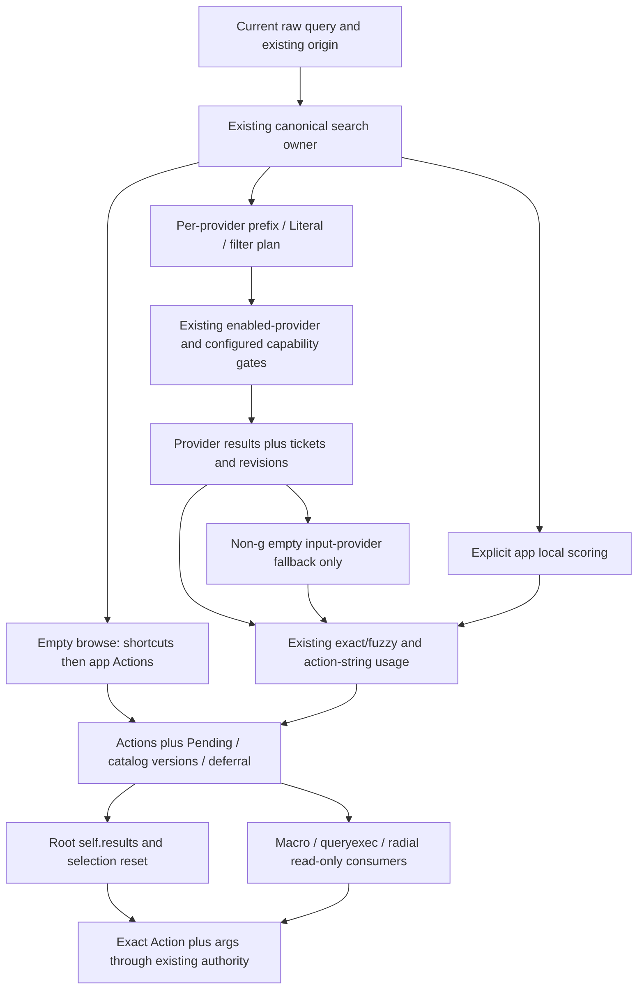

# Current search architecture — Goal 02 / M1-A

Application source: `59156d96adcc73939c7171487a0cb582e3286587`. Goal 02 branch starts at closed audit documentation `3b79d73f12a791b8b077ed0bf7d6631bd885b68c`; planner checkpoint `a6a16395eeab1bc8bc8de17c54ed88d3112fc9ae` is pushed. This document is static source/caller/test reasoning, not a Rust run or provider probe. It incorporates the closed audit's [review corrections](../01-static-audit/REVIEW_AND_LIMITATIONS.md); Goal 01 is frozen.

The launcher **already has** prefix/literal routing, action filters, fuzzy/exact scoring, aliases, usage weighting, completion, provider tickets and multiple command authorities. Research concerns a separate proposed interactive tool-discovery projection, not a missing ranker or a replacement dispatcher. The [capability catalog](COMMAND_AND_CAPABILITY_CATALOG.md) and [JSON](catalog/catalog.json) describe existing fixed openers as research metadata; no catalog is registered in the application by this checkpoint.

## 1. Owners and separate catalogs

| Owner / current type | Responsibility / boundary |
|---|---|
| `actions::Action` | Serialized label/description/action/optional args. Preserve full exact payload; current usage key is narrower than payload identity. [S1] |
| `LauncherApp.actions`, command cache, search caches | Custom/indexed application Actions and metadata; command shortcuts from providers; cached lowercase text and existing aliases; published root results/selection. These are distinct from a tool capability catalog. [S2] |
| `PluginManager`, `PluginSearchSnapshot`, `PluginSearchUpdates` | Provider registration/locks/lifetime, query plans/gates/results, tickets/generations and snapshot ownership. Search can initiate work or effects; it is not a metadata-enumeration API. [S3] |
| `PluginCatalogSnapshot` / `PluginCatalogEntry` | Existing Settings-oriented immutable name/origin/epoch/enabled/declared-capability metadata, revisioned without provider locks/private config. It is a viable future metadata input, not a complete reserved-prefix view. [S4] |
| `SettingsCatalog::from_plugin_snapshot` | Separate Settings navigation/search projection, including ambiguous-name handling. Reuse ownership ideas; do not replace Settings entries with tool descriptors. [S5] |
| `completion::build_index` / `suggestions` | Lowercase/deduplicated prefix FST over command labels and `app <label>`, at most five UI suggestions, excludes exact query; not semantic candidate ranking. [S6] |
| Typed commands / Universal Actions | Parse exact Action/args, validate domain/capability/availability, preserve source/surface/confirmation and execute through existing hosts. Result relevance is not authority. [S7] |
| Usage/history/pins | Counts by action string; raw history and saved action+args/context have different identity and retention. No observed-user data is loaded for this research. [S8] |

Capacity deferral is a different path: it passes **already-scored empty provider results directly to composition**, so it bypasses the fallback box. The diagram is ownership/data flow, not a claim every arrow occurs for every query.

## 2. Exact current route/fallback matrix

| Situation | Actual current path / result | Compatibility consequence |
|---|---|---|
| Empty or whitespace | Command cache clone, followed by catalog Actions with `app ` displayed labels; original action/args retained. Outcome Results, no provider call for this branch. | Browse order is not nonempty score order; injecting shortcuts changes browse and completion. [Q1] |
| `app` / `app ` (case-insensitive trimmed route) | Local application tail passes action filters and existing exact/fuzzy scoring; providers still follow their own plans. | Unprefixed natural text is not automatically local-app catalog search. [Q2] |
| `g ` route | Provider set is replaced with `{web_search}`, rather than intersected with ordinary enabled providers; configured capability map remains passed. Its provider scorer returns before command fallback. | Ordinary enablement semantics are not universal. Preserve this exception and lack of command fallback, even for empty provider output. Manager route lowercases for detection; WebSearch's own implementation has its own exact `g ` acceptance. [Q3] |
| Non-`g`, **input provider vector empty** | `search_plugins_from_results` checks emptiness before post-filter; command cache exact/fuzzy fallback may supply candidates. | Fallback is not a generic final-empty-results handler. [Q4] |
| Nonempty input provider vector becomes empty during exact post-filter | Provider branch completes; no retry through command fallback. Local app rows can still compose where applicable. | Do not add fallback after filtering by assuming it already exists. [Q4] |
| Provider capacity occupied, nonempty query | `search_read_only_outcome` calls final composition directly with no scored provider rows, pending=true and catalog stability false; marks deferral Capacity. | `app` can retain local matches; other nonempty routes can remain row-empty. **No command fallback** here. [Q1] |
| Failed-provider query reopened for manual editing | Separate `search_read_only_outcome_without_providers` calls provider-result scorer with empty input vector; avoids reentering failed provider/capacity path. | Non-`g` command fallback can occur here. Do not equate failed-provider reopening and capacity deferral. [Q1] |
| Snapshot/radial query resolution | Supplied provider snapshot results pass through the same scorer/final composition; current result/context/lease fences remain radial-owned. | Shared order is baseline; snapshots do not license new interactive discovery rows. [Q1], closed audit handoff. |

`update_command_cache` invokes existing `commands_filtered(enabled_plugins)`, sorts by lowercase label and rebuilds command search/FST inputs. This enumeration filters enabled plugin names, **not the enabled-capability map**. A capability-denied search provider and its shortcut cache should not be conflated. No new discovery descriptor belongs in this current cache under the planner boundary. [S2]

## 3. Provider policy, metadata and safe enumeration

`PluginQueryPolicy::ActionFilters` is the trait default. Search splits action filters once, derives each provider's query plan and applies metadata filters to returned Actions. Matching-prefix `Literal` means the original head matches a declared prefix; then the provider receives original query and skips action filters. Declaring Literal alone does not protect unrelated query heads. QR supplies an explicit case where spaces/quotes/filter-looking text are data. [S3]

Current `plugin_matches_search` checks current explicit enabled-provider set and a configured per-provider capability restriction: absent map entry is unrestricted; present list lacking `search`, including empty, rejects. `always_search` then bypasses prefix routing; otherwise empty prefix list is global, or head must match a declared prefix. The function does **not itself test `capabilities()` for a declared `search` string**. Declared capability metadata and configured restrictions are separate inputs; SEARCH-F001's proposed discovery eligibility additionally requires declared search. [S3], [S4]

Registration records builtin/dynamic/registered origin and epoch. Cached metadata snapshot sorts by name/origin/epoch and carries revision/current requested runtime enablement; it excludes handles/private settings. Snapshot enablement is not the caller's complete configured-capability map. `SettingsCatalog` detects ambiguous names and prevents same-name dynamic owners inheriting builtin annotations. A future discovery projection should preserve that distinction; current general provider search does not automatically implement the proposed builtin-only policy. [S4], [S5]

`has_enabled_query_prefix` iterates providers, builds their plans and checks **enabled searchable** prefix matches. It can take provider read locks and omits disabled/capability-denied routes. It is not a complete reserved-syntax registry, and SEARCH-F001's eleven opener descriptors do not solve this missing integration contract. Complete protected-prefix inventory remains a future UI-integration prerequisite. [S3]

Never call arbitrary `Plugin::search` to construct this research catalog. Calculator search can append calculation history under current settings; Omni already owns content search and can traverse its actual configured sources. `commands()` are current provider-produced shortcuts, not a side-effect-free universal capability descriptor interface. Here all metadata/payloads are read statically. [S9]

## 4. Existing scoring, ordering and completion

Let F=`fuzzy_weight`, U=`usage_weight`, n(a)=current count keyed by `a.action` (not args/label). Existing exact mode is `match_exact` or F≤0; defaults F=1/U=1. Final scored composition adds n(a)×U, then sorts descending using floating `partial_cmp` with Equal fallback. There is no explicit stable semantic-ID tie breaker or normalization joining provider score scales. This is source behavior, not measured relevance or determinism by identity. [Q2], [Q4], [Q5], [S8]

| Candidate class | Existing inclusion/base score |
|---|---|
| Local `app` empty filtered tail | All Actions passing metadata filters, base0. |
| Local exact | Case-folded displayed label/description/action-string or alias match; alias base1, otherwise0. |
| Local fuzzy | Requires a label or description matcher hit; maximum score×F. |
| Provider fuzzy | Returned Actions retained even if label/description match fails; maximum against raw query, or0, timesF. Provider query processing may already have resolved semantic/typed output. |
| Provider exact | `g` uses its tail. Other provider branch derives a term after head/subcommand: initially second space-separated token of the tail; if empty, single non-SUBCOMMAND tail uses itself, multiword tail uses tokens after the first. Exact display/description/action/alias checks apply, except current resolved-output bypasses. This heuristic is not a general intent parser. |
| Resolved exact outputs | Existing exceptions include QR, selected note results, Clipboard Modify and date outputs; query suggestions do not get blanket bypass. Preserve legitimate returned output instead of assuming it must contain the original command words. |
| Command fallback | Existing exact/alias or successful label/description fuzzy matching over command cache, only in the route conditions above. |

The production fuzzy matcher is existing application code; a future Python lexical baseline cannot be called the launcher implementation. New research ranking policy and stable ties will be specified at M1-B; none is selected/executed now.

Completion is its own lowercase prefix FST: command labels plus `app <catalog label>`, sorted/deduplicated, excludes query itself. App scheduling debounces rebuilds, clears suggestions/index when dirty, and returns up to 5 suggestions only when enabled/nonempty/not dashboard. It is not action execution or a synonym discovery engine. [S6]

## 5. Pending, replacement and selection

`LauncherSearchOutcome` carries Actions, state, provider revision, result-catalog versions/stability and provider deferral. Pending can coexist with rows and occurs for pending providers, changing start/end provider revision or unstable result catalogs. Capacity deferral and current row count are separate facts. Tickets/generations describe publication and rejection, not worker retirement. [Q1], [Q5]

Root `search()` records those facts and clears current `selected` on cache hit, equal-result reuse and replacement; vector/geometry reuse does not preserve selection. Refresh uses current `self.query`, not worker-captured old text. Capacity-release refresh requires the expected current query/cache state. Deferred Enter/click clones the exact Action+args; normal activation is not a universal provider-provenance resolver. Radial has additional current lease/target/revision/confirmation gates from the closed audit. [Q6], [S7]

Example: A starts work, user edits B, then A finishes. Existing owner invalidates/refreshes B from current state or rejects stale radial work. No new discovery may restore A or retarget selection by numeric row. A stronger immutable discovery-row binding/current owner/epoch check is **proposed policy**, not a guarantee already present on every legacy row.

## 6. Automatic and programmatic consumers — why shared vectors remain unchanged

| Current consumer | Exact behavior / source-surface consequence | Discovery exclusion |
|---|---|---|
| Production Macro query command | `ProductionLauncher::command` submits to `LauncherCommandBroker`. GUI sets query, invalidates, searches; zero→NoResults, one→clone/activate with Macro source, many→show selection. It does not await pending. Backend success includes Activated **or PresentedForSelection**. | New shared rows could turn zero into execution, one into chooser or change first target. Preserve exact instantaneous cardinality and handoff semantics. [A1] |
| Macro ResolvedLegacy | Newer command broker passes already-resolved Action, activates Macro source, retains interaction restoration policy. | No re-ranking or new natural-language interpretation. [A1] |
| Exported compatibility Macro query broker | GUI polls old broker, sets query/searches, activates **first** row with Enter source, errors if none. Bounded src/tests search in closed audit found no production submit caller; external consumers not disproved. | Do not delete/unify it or change first-row semantics to improve discovery. [A1] |
| `queryexec:` command | Canonical parser yields `QueryCommand::ExecuteFirst`; handler sets query/search and activation source. Outcome applier clones first `self.results` Action and activates, with existing radial recursion guard. | No discovery candidates in those results; no implicit guessed operation. [A2] |
| `query:`/launcher-show query/saved shortcut | Sets/replaces query and invokes existing search/outcomes. Programmatic text can appear in root UI. | Visibility in main launcher is not fresh user origin; future discriminator must preserve programmatic origin until actual edit. [A2] |
| Radial saved query and authoring | Read-only/snapshot canonical search and current target/lease/catalog checks; saved references and selection are distinct. | Keep canonical result set/order/cardinality; radial discovery is outside initial proposal. Closed audit source anchors apply. |
| Dashboard selected-provider widgets | Explicit widget filter grammar plus query shortcut/click behaviors, not manager Literal parity. | Do not add a global query-policy rewrite or recast selected-provider results as this catalog. |
| Completion/empty browse/quick help | Existing command-cache labels/shortcuts and their order/count. | New metadata does not add commands or completions. [S2], [S6] |
| Hot Folder/gestures/hotkeys/headless | Existing exact Action, typed domain controls or restricted unattended resolution; not a general fresh interactive natural-language consumer. | Retain exact source and domain eligibility; no inferred execution. [S7], closed audit. |

`ActivationSource`, `ActionSurface` and `UniversalActionInvocationContext` are the actual source symbols. `ActionSurface` includes LauncherList/LauncherGrid plus sheets/menus/dashboard/radial/gesture. There is no claimed existing `MainLauncher` enum or `CommandInvocationSource`; user-origin and main-launcher-only admission are proposed integration policy. Click/Enter retain their real source, and a separate presentation row origin would prevent new discovery storage from leaking into legacy automatic consumers. [A3]

## 7. Usage/history identity and privacy

Current usage is `UsageEntry {action:String,count:u32}` persisted replaceably after revalidating existing bytes and taking transaction/repair read authority. Root ranker adds count by action string; args variants share counts. Recording history/usage uses exact Action/query/source and target-repair coordinated saturating deltas, with current repair exit handoff before save. History stores raw query/full Action/source/time, appends under process-local lock, trims by configured count on append (default 100), then publishes committed memory. Pins identify action string **plus args** and durably persist current updates. [S8], closed handoff.

No current usage timestamps/recency/time-of-day signal, TTL or byte bound is established by usage type. History timestamps are not automatically permitted personalization input; a recorded activation/chooser response is not a completed-effect success label. Clipboard, Macro summaries, OCR/pixels, file paths/receipts and explicit presets have different sensitivity/retention. Research catalog uses no user records; future evaluation uses synthetic counts only. No data migration/personalization recommendation is accepted at M1-A.

## 8. Safe discovery seam and unresolved requirements

The planner's proposed separate flow is interactive current query → protected-route admission → immutable eligible builtin metadata → pure discovery ranker → **separate presentation collection** → explicitly selected exact Action → existing activation. This topology preserves `LauncherSearchOutcome.actions`, `self.results`, command cache/completion and all automatic consumers. It is a design target, not current production behavior or a new accepted author package.

Initial proposed admission is opt-in, fresh user edit, LauncherList/LauncherGrid, bounded natural text, complete protected syntax inventory, no provider pending/deferral/unstable catalog and no canonical results. Current low-score provider rows can therefore suppress discovery; measure/report that coverage loss later instead of weakening eligibility to make synthetic relevance look good. Complete revisioned reserved-prefix inventory, user/programmatic origin, selected-row immutable binding and live revalidation remain **unresolved future integration requirements**. SEARCH-F001 alone supplies none of those consumers/guards.

This checkpoint accepts no new actionable recommendation. It documents the existing SEARCH-F001 planner foundation and source-verified research-only extensions. M1-B defines grammar/rank/integration; M1-C freezes corpus/protocol; no evaluator/prototype is run before those dependencies.

## Source references

[S1]: https://github.com/multiplex55/Multi_Launcher/blob/59156d96adcc73939c7171487a0cb582e3286587/src/actions/mod.rs#L12-L19
[S2]: https://github.com/multiplex55/Multi_Launcher/blob/59156d96adcc73939c7171487a0cb582e3286587/src/gui/search.rs#L707-L767
[S3]: https://github.com/multiplex55/Multi_Launcher/blob/59156d96adcc73939c7171487a0cb582e3286587/src/plugin.rs#L1310-L1437
[S4]: https://github.com/multiplex55/Multi_Launcher/blob/59156d96adcc73939c7171487a0cb582e3286587/src/plugin.rs#L1108-L1159
[S5]: https://github.com/multiplex55/Multi_Launcher/blob/59156d96adcc73939c7171487a0cb582e3286587/src/settings_editor/catalog.rs#L272-L318
[S6]: https://github.com/multiplex55/Multi_Launcher/blob/59156d96adcc73939c7171487a0cb582e3286587/src/completion.rs#L1-L48
[S7]: https://github.com/multiplex55/Multi_Launcher/blob/59156d96adcc73939c7171487a0cb582e3286587/src/gui/actions.rs#L69-L187
[S8]: https://github.com/multiplex55/Multi_Launcher/blob/59156d96adcc73939c7171487a0cb582e3286587/src/usage.rs#L1-L96
[S9]: https://github.com/multiplex55/Multi_Launcher/blob/59156d96adcc73939c7171487a0cb582e3286587/src/plugins_builtin.rs#L58-L110
[Q1]: https://github.com/multiplex55/Multi_Launcher/blob/59156d96adcc73939c7171487a0cb582e3286587/src/gui/search.rs#L1395-L1498
[Q2]: https://github.com/multiplex55/Multi_Launcher/blob/59156d96adcc73939c7171487a0cb582e3286587/src/gui/search.rs#L989-L1089
[Q3]: https://github.com/multiplex55/Multi_Launcher/blob/59156d96adcc73939c7171487a0cb582e3286587/src/gui/search.rs#L1125-L1242
[Q4]: https://github.com/multiplex55/Multi_Launcher/blob/59156d96adcc73939c7171487a0cb582e3286587/src/gui/search.rs#L1245-L1392
[Q5]: https://github.com/multiplex55/Multi_Launcher/blob/59156d96adcc73939c7171487a0cb582e3286587/src/gui/search.rs#L1579-L1676
[Q6]: https://github.com/multiplex55/Multi_Launcher/blob/59156d96adcc73939c7171487a0cb582e3286587/src/gui/search.rs#L817-L985
[A1]: https://github.com/multiplex55/Multi_Launcher/blob/59156d96adcc73939c7171487a0cb582e3286587/src/gui/render.rs#L3095-L3191
[A2]: https://github.com/multiplex55/Multi_Launcher/blob/59156d96adcc73939c7171487a0cb582e3286587/src/gui/command_host.rs#L2327-L2344
[A3]: https://github.com/multiplex55/Multi_Launcher/blob/59156d96adcc73939c7171487a0cb582e3286587/src/universal_actions/model.rs#L104-L145

Additional exact authority anchors: [source enum](https://github.com/multiplex55/Multi_Launcher/blob/59156d96adcc73939c7171487a0cb582e3286587/src/commands/model.rs#L14-L42), [query handler](https://github.com/multiplex55/Multi_Launcher/blob/59156d96adcc73939c7171487a0cb582e3286587/src/commands/handlers/launcher_query.rs#L36-L52), [Macro success/handoff](https://github.com/multiplex55/Multi_Launcher/blob/59156d96adcc73939c7171487a0cb582e3286587/src/mkmacro/executor.rs#L593-L613), [metadata fields](https://github.com/multiplex55/Multi_Launcher/blob/59156d96adcc73939c7171487a0cb582e3286587/src/plugin.rs#L382-L422), [registration origin](https://github.com/multiplex55/Multi_Launcher/blob/59156d96adcc73939c7171487a0cb582e3286587/src/plugin.rs#L1031-L1079), [shortcut enabled filtering](https://github.com/multiplex55/Multi_Launcher/blob/59156d96adcc73939c7171487a0cb582e3286587/src/plugin.rs#L1174-L1185), [Omni content owner](https://github.com/multiplex55/Multi_Launcher/blob/59156d96adcc73939c7171487a0cb582e3286587/src/plugins/omni_search.rs#L129-L165).
