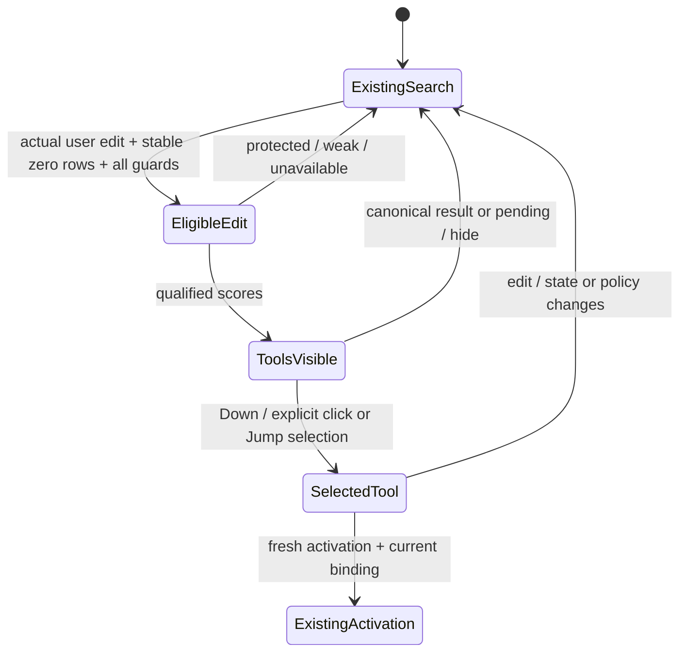

# Keyboard and results UX — proposed discovery

M1-C research specification; no UI implemented. Source baseline `59156d96adcc73939c7171487a0cb582e3286587`; M1-B accepted/pushed `cc3da667348df76abdd81bb4057a0df8393089fc`. [Runtime design](RUNTIME_AND_INTEGRATION_DESIGN.md) still classifies UI integration **NOT_IMPLEMENTATION_READY**: complete usable admission coverage/default-like reachability is unresolved. The wireframes below are conditional designs, not screenshots or observed behavior.

## What the user is choosing

Tool suggestions open existing tools. They do not load, format, compare, hash, search, paste or change data from the search sentence. A dialog may retain its own earlier draft/session/work; opening is not a promise that every existing tool starts empty. The section labels the opening effect plainly, rather than implying an operation already happened.

```text
Search: open checksum tool

Tools
  Open Hash Generator                         Opens tool
  Hash text or a file you choose in the tool

Choose a tool with Down or click it. Enter opens your selection.
```

No row is selected when the section first appears, including a strong single suggestion. No completion text or guessed file/clipboard data is inserted. The current query is not copied into a dialog's args, path, input, clipboard or query override. Explanations are short trusted phrases such as “Matches checksum”; no numeric confidence percentage or backend internals are shown.

```text
Search: compare

Choose a tool
  Open Image Comparison                       Opens tool
  Compare images by exact pixels
  Open Diff                                   Opens tool
  Compare files or folders you choose
```

The second row exists only in the full research scope; initial eleven shipping metadata does not include Diff. Display order follows the deterministic policy, while a tie does not imply one tool is the intended operation. Explicit selection remains required. Actual shipping subset must be decided before final product copy/acceptance.

## State and keyboard contract

| Situation / action | Proposed visible behavior and ownership |
|---|---|
| Known explicit prefix/Literal/filter/path/URL/payload | Existing canonical results/feedback only. No discovery section or message rewriting the user's syntax. `g`, `app`, QR, snippets and selected-provider dashboard grammar stay owned by current paths. |
| Fresh natural edit, stable zero canonical rows, permitted configuration | Show at most five qualified tool rows in a separate section. Stronger suggestion versus chooser uses the frozen policy; no new scope bar or mode switch. |
| Empty input | Existing browse remains unchanged. No tool promotion into command cache/completion/empty browse. |
| Feature off | Existing launcher behavior; no upsell/banner per keystroke. Settings may describe the optional feature, default off. |
| Providers pending/capacity deferred/current results arriving | Existing canonical loading/results behavior. Remove discovery rows/selection immediately; do not claim “nothing found” or expose worker tickets. |
| Setup lacks a complete supported admission contract | With opt-in on, a quiet non-action row may say “Tool suggestions aren't available in this setup.” Settings can explain supported scope. No provider names, epochs or `Unknown` enum text in product flow. It must not imply the 43 unresolved global contracts are solved. |
| Too-long/protected punctuation/locale/short query | Preserve canonical text and behavior. If already displaying a discovery empty-state, use “No matching tool” rather than displaying internal bounds. No automatic stripping/rewriting. |
| Unsupported/destructive request | No executable discovery row. “No matching tool” is sufficient; do not convert “delete duplicates” into a default Duplicate Finder action or promise missing ZIP/history/export features. |
| Qualified but weak/no match | No executable row; optional “Try a tool name.” Never show an arbitrary first catalog entry to avoid an empty page. |
| Down from root input with visible discovery | Explicitly select the first bound tool row. Further Down/Up moves among those current rows. Up at the first row clears discovery selection and returns navigation to query editing. Existing input owner gets the event once. |
| Enter with no discovery selection | Does not open a discovery tool. Existing canonical Enter path receives no injected row. No “best guess” auto-selection. |
| Enter with explicit selected tool | Capture immutable current binding, revalidate, then use existing activation with actual Enter source and None override. Row removal/revision/eligibility change clears selection instead of substituting another row. |
| Click a current row | One explicit select-and-activate gesture using that captured binding and actual Click source; revalidate before dispatch. Hover changes neither selection nor activation target. |
| Tab/completion | Preserve current completion semantics and command set. A completion/programmatic query replacement does not become a fresh edit merely because it is visible; a subsequent user text edit is the explicit transition. Discovery adds no completion strings. |
| Escape | Existing Jump/modal/root Escape owner retains precedence. Discovery adds no extra Escape layer; clear its binding when the owner cancels, clears or hides the interaction. |
| Existing Jump Mode | Keep current activation chord, generations, target registration and fresh-Enter fencing. Only visible/current tool rows can register stable targets. Re-rendering/reranking never retargets a hint/index to a different Action. No new synthetic input, delays or hotkey. |
| Modal, confirmation or child tool opens | Existing focus/root-child/confirmation owners win. Clear the discovery binding before dispatch. No delayed root restore may steal focus from an opened child. |
| Tool disabled/replaced while selected | “That tool is no longer available. Choose again.” Clear selection/rows as needed. No re-enable side effect, fallback action, numeric-index reuse or silent replacement. |

Canonical results and discovery are separate internal collections; this initial design requires zero canonical rows before suggestions. The product still has one search input. A low-score existing row can suppress discovery, and that lost coverage remains visible in evaluation/reporting rather than bypassing canonical precedence.

## User origin and state transitions

An actual insertion/deletion/paste into the visible root input marks fresh user origin and increments query generation. Showing the launcher, focus changes, saved-query restoration, Macro/queryexec assignment, history/completion insertion or automatic callbacks do not. A pasted raw payload can still be protected. New user edits clear selected binding before rerank. Identical-stamp repaint does not rerank or change a selected payload.



The actual enums remain ActivationSource and ActionSurface; query origin/binding types are proposals. M1-C fixtures test pure state inputs, not native focus or OS timing. Action sheets/ContextMenu/Dashboard/RadialMenu/Gesture and automatic contexts remain excluded. Contextual Universal Actions, if later offered for a selected real result, must use existing target/type/availability/confirmation rather than become tool-discovery operations.

## Future focused acceptance

Future integration should prove explicit selection/no-default Enter, list/grid origin transition, query/metadata/disable invalidation between selection and Enter, exact payload capture, existing Jump/modal/fresh-Enter precedence and opening retained tool state honestly. Preserve Macro zero/one/many and legacy/queryexec first-row behavior by leaving shared vectors unchanged. No pixel-perfect campaign or native run occurs here. The standalone prototype can verify only declared row/output/state fixtures; it cannot prove this UI interaction or live reachability.
