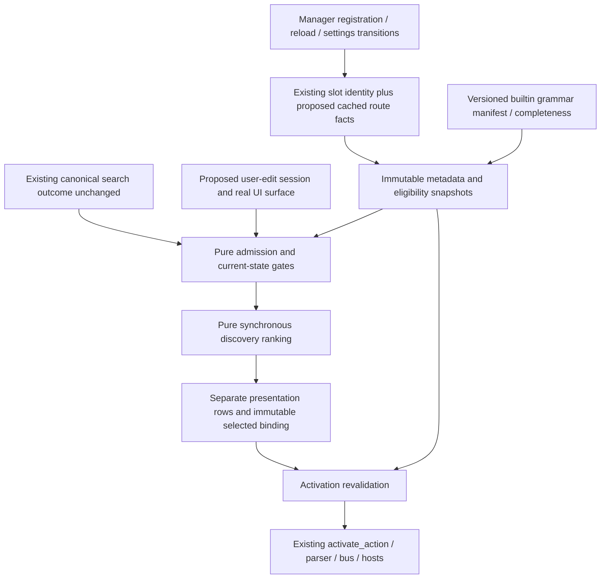

# Runtime and integration design — M1-B

Status: **PROVISIONAL_RESEARCH_DESIGN / UI_NOT_IMPLEMENTATION_READY**. Source `59156d96adcc73939c7171487a0cb582e3286587`; M1-A accepted/pushed `80b2050a6e6c0a78b90bbfb60db822d399d2c82d`. These are proposed contracts and future engineering targets, not measured Rust/native results. [Current architecture](CURRENT_SEARCH_ARCHITECTURE.md), [grammar](INTENT_TAXONOMY_AND_GRAMMAR.md) and [ranking](RANKING_SPECIFICATION.md) distinguish existing behavior from the new projection. No production source, ranker, evaluator or native application ran.

## 1. Ownership and narrow modules

Keep canonical search and all its consumers intact. Proposed pure domain code lives in `src/discovery/{mod,model,admission,ranking}.rs` inside the current crate; no new crate or plugin ABI. `PluginManager` remains registration/identity owner, source plugins retain fixed opener construction, Settings retains save authority, GUI owns presentation/session selection and existing command/Universal Action paths retain execution authority.



No discovery edge writes `LauncherSearchOutcome.actions`, root `self.results`, command cache, FST/completion, Macro/queryexec/saved/radial resolver or dashboard widgets. Existing future-search/pending/native workers are observed through current stamps, never owned/stopped by this ranker. Rejecting a stale result is not retiring those workers.

## 2. Proposed records and interfaces

Illustrative Rust sketches name architectural concepts, not compiled/required exact source names:

```rust
struct DiscoveryId(/* validated bounded ASCII identifier */);
struct OwnerKey { origin: PluginCatalogOrigin, name: String, epoch: u64 }
struct DiscoveryStamp {
    session: u64, query_generation: u64, metadata_revision: u64,
    route_revision: u64, policy_revision: u64, eligibility_revision: u64,
    provider_revision: u64, result_catalog_versions: /* existing versions */,
}
enum QueryOrigin { FreshUserEdit, Programmatic, SavedQuery, Automatic, Unknown }
enum RouteCoverage { Complete, Unknown { unresolved_count: usize } }
enum ReservedGrammar {
    DeclaredHeads(Vec<String>),
    ReviewedGrammar(/* finite pure guards; no arbitrary callbacks */),
    ReviewedGlobalContent { /* documented raw-content protection scope */ },
    Unknown,
}
struct ReservedRouteSnapshot { revision: u64, coverage: RouteCoverage, /* owners, guards */ }
struct DiscoveryDescriptor {
    id: DiscoveryId, owner: OwnerKey, exact_action: Action,
    /* bounded label/aliases/intent/object vocabulary/effect: OpenExistingTool */
}
struct DiscoveryRowBinding {
    id: DiscoveryId, owner: OwnerKey, stamp: DiscoveryStamp,
    exact_action: Action, /* immutable score/explanation; no query prefill */
}
enum PresentationRow { Canonical(/* existing identity */), Discovery(DiscoveryRowBinding) }
```

The existing types are `PluginCatalogOrigin`, `Action`, `commands::ActivationSource`, `ActionSurface`, `UniversalActionInvocationContext` and current search/version records. QueryOrigin/DiscoveryStamp/PresentationRow are **new proposals**. Origin describes how query text arose; ActivationSource describes triggering input; ActionSurface describes presentation. A click remains Click, Enter remains Enter. No new `MainLauncher` or `CommandInvocationSource` enum is claimed. [S1], [S2]

Proposed pure interfaces are `project_descriptors(plugin_snapshot, configured_policy, source_descriptors) -> Projection`, `classify_admission(raw_query, origin, surface, canonical_state, route_snapshot) -> Admission`, and `rank(admitted_query, projection, policy) -> DiscoveryOutcome`. No provider/OS/settings/persistence handle enters these functions. GUI's proposed `activate_bound_discovery(binding, source, surface)` revalidates the whole stamp/owner/payload, then calls existing `LauncherApp::activate_action(exact_action.clone(), None, source)`. Query override is None; parser/dispatcher/confirmation and tool hosts remain authoritative. There is no new generic operation executor. [S3]

Universal Actions are not queried/executed merely to enumerate tools. If a later result action sheet is offered, it must use the real `UniversalActionInvocationContext`/selected target availability and retain existing source/surface/confirmation; that is outside the initial opener-only UI. No separate Universal Actions package is accepted here.

## 3. Complete reserved-route metadata: owner and publication protocol

Current immutable Settings metadata caches name/origin/epoch/capabilities, not complete route facts. `has_enabled_query_prefix` uses provider read locks and omits disabled/denied owners. Existing registration applies plugin settings before slot creation; the manager is the right place to capture existing `query_prefixes`, `query_policy`, `always_search` alongside identity **outside query-time handling**. This reuses trait methods, with no new plugin method or dynamic ABI. [S4], [S5]

The future integration design adds a separate manager-owned route revision/snapshot, not a misleading reinterpretation of Settings catalog completeness:

1. Before registration/reload/settings mutation, publish a transitioning/Unknown route state and invalidate all discovery rows. Read current route declarations at the existing exclusive construction/mutation boundary. Do not acquire provider locks from every keystroke. A busy/malformed metadata refresh remains Unknown and discovery stays suppressed; canonical search proceeds unchanged.
2. Cache all registered owners' declared heads/policy/always-search, including disabled/capability-denied owners. Validate bounded ASCII heads and identity; never filter reserved syntax using discovery eligibility. A new epoch or origin does not inherit the previous name's review annotation.
3. Join those facts against a **versioned first-party builtin coverage manifest** keyed by actual builtin type/name plus reviewed declaration/body contract. A nonempty declared-prefix route with `always_search=false` has a manager-enforced head boundary; use `DeclaredHeads`. Manager-global/always-search providers require `ReviewedGrammar` or a documented `ReviewedGlobalContent` classification. Unknown is explicit, never “empty prefix means safe.”
4. A reviewed grammar guard is finite data interpreted by pure admission: whitespace-delimited heads, raw starts-with markers, adjacent prefixes such as Snippets' `csfoo`, and global-content scopes/exclusions where source review establishes them. No plugin callbacks, provider `search`, config values or raw content go into admission. A setting-dependent grammar must declare which immutable configuration-derived route metadata/revision controls it; if that cannot be represented completely, mark it Unknown.
5. Publish Complete only when every currently registered owner's required contract is classified/current and all known disabled routes are preserved. Structural/declaration inconsistency invalidates the whole completeness claim, not just the affected descriptor. Copy a bounded snapshot to GUI only when revision changes; source hashes/manifest revision are build provenance, not runtime filesystem checks.
6. Registration/unload/reload, route-affecting settings and enablement/capability policy changes bump revisions before rows can activate. Even if a policy change does not alter reserved heads, it invalidates descriptor eligibility. Retain known unloaded heads as session tombstones so an old explicit route cannot suddenly become natural discovery. An unclassified opaque plugin loaded then unloaded leaves Unknown for that session; restart rebuilds from the current roster. This conservative cost is explicit and can be rejected during future integration review.

External DynamicLibrary/Registered providers are initially Unknown, even with finite prefixes, because origin-specific undeclared/always-search grammar is not proven by builtin annotations. No natural-language discovery is allowed in that configuration under this design. A future policy could review non-builtin metadata separately, but it is not silently added to this scope. Canonical dynamic-plugin functionality continues unchanged.

The manifest must also assert route stability between observed manager mutations. If a builtin's declarations/grammar can change from unobserved interior state or search-side effects, a construction-time copy is insufficient: identify its existing publication revision and invalidation owner, or classify it Unknown. This requirement cannot be solved by assuming all trait metadata is static; no new plugin callback/ABI is introduced to hide an untracked transition.

Bound the route snapshot to **256 owner records**, **512 reserved head/guard records**, **64 UTF-8 bytes per simple head** and **128KiB total serialized route metadata**; overflow/malformed/unknown guard version yields Unknown, never truncation. Heads are matched against raw input according to each finite guard before discovery normalization. Known content matchers may be allowed to receive ordinary natural text through canonical search; zero canonical results then permits discovery only if their review proves no additional protected grammar. Being a global content matcher is neither inherently Unknown nor proof of completeness.

### Actual coverage and reachability gap

The parent's [bounded routing survey](roles/orchestrator/ROUTING_METADATA_SURVEY.md) identifies **81 unique statically registered builtin types**, not the audit's 85 plugin-file inventory: 37 nonempty prefix overrides,44 default-global; Snippets declares `cs` but `always_search=true`, yielding **36 manager-prefix-gated and 45 manager-global** types under unrestricted policy. Default settings use None/None for provider/capability restrictions. This is declaration/source inventory, not a runtime active roster or completed body-grammar audit. [S6]

Current body evidence qualifies Web Search and Calculator as **reviewed head/marker grammars despite global metadata** (`g`, `=`, `calc`), rather than opaque unrestricted language consumers. Snippets' adjacent `csfoo` proves declared head-only metadata is insufficient there. The other 43 manager-global grammars remain unclassified at this checkpoint, including any real global content matchers; do not classify all 43 unsafe or assume them harmless. The 36 prefix-gated entries have manager head boundaries, but a future manifest must still capture/reconcile their actual identities/declarations and setting changes. [S7], parent survey.

| Configuration/coverage class | Proposed admission result / quantifiable cost |
|---|---|
| Default-like81-builtin roster with this checkpoint's evidence | Complete is **not established**; at least43 global body contracts unclassified. Treat Unknown: **100% of otherwise eligible discovery queries suppressed** in that configuration. No claim about fraction of users/configurations. |
| Only Hash enabled, others registered but disabled | The same Unknown contracts still count. Disabled known syntax is reserved; this allowlist **does not evade** missing global coverage.100% suppression until manifest complete. |
| Every registered contract reviewed/current, no opaque external owner | Complete can be published; natural text can proceed to canonical outcome and eligibility gates. This is the intended future reachable class, not proven default live coverage now. |
| Any one unclassified/global/setting-dependent or external opaque contract, stale transition or overflow | Unknown count≥1 blocks all discovery admission. Report the reason/count in diagnostics; no silent fallback to enabled-prefix detection. |
| Feature disabled | No discovery work/rows. Canonical behavior unchanged; no implication that prefix inventory is complete. |

**Conditional source-derived eligible sequence:** after a future integration has completed the manifest (not merely loaded this research JSON), use an ordinary explicit configuration with enabled set `{hash_generator}`, configured search permission, exact-match mode true and feature opt-in. Fresh root user text `open checksum tool` is not Hash's `hash` head, is not `app`/`g`, and ordinary enabled-provider planning supplies no Hash result. Exact command fallback contains only the existing Hash shortcut; its label/description/action do not contain the whole query, so it supplies no row. With stable/no-pending canonical outcome and no protected-route match, normalization leaves `checksum`; eligible Hash receives the P1/P2 strong opener suggestion. This follows current routing/gating and exact fallback source, with no runtime probe. It demonstrates a plausible **conditional path**, not that a Complete manifest or default-like live reachability has been achieved. [S8], [S9]

Future UI acceptance must resolve those 43 actual global contracts (a focused source task, not a new general plugin ABI), explicitly decide default-like reachability, and demonstrate at least one real supported configuration with current canonical behavior. If they cannot be represented completely at proportionate cost, choose a bounded decision spike/narrower feature or reject UI integration. Synthetic Complete/empty contexts only test conditional ranker rules; their discovery rates must not be reported as live/default coverage. This acceptance/spike gap is substantive and does not block a standalone metadata/pure-ranker proposal.

## 4. GUI lifecycle, immutable selection and activation

| Event | Proposed state transition / invariant |
|---|---|
| Startup | Feature defaults false. Build no discovery projection/ranking data until enabled; manager's small route declaration cache can be prepared with existing registration. Never start workers/services/providers for metadata. Unknown coverage produces no rows. |
| Actual text insertion/deletion/paste into visible root query | Increment session-owned query generation, mark FreshUserEdit, clear old selection/rows before ranking. Pasted content can fail raw grammar; do not read clipboard independently. History/completion/programmatic replacement stays Programmatic/SavedQuery until a later actual user edit. |
| Show/hotkey/focus/Jump registration without edit | Does not create FreshUserEdit. Root close/reopen starts a new session with Unknown/programmatic origin unless a real user edit occurs. No synthetic input or focus workaround. |
| Canonical search/revision refresh | Run existing behavior first. Pending/deferral/nonempty/stale results clear discovery and its selection. A transition back to stable zero rows may rank current text only if origin/session remains valid; it cannot restore an older row/selection. |
| Ranking/publication | Synchronous over one immutable snapshot. Recheck stamps before publishing. Results are separate rows with exact Action/owner/stamp bindings and stable widget/Jump IDs derived from session+descriptor+owner epoch; never root numeric result index. |
| User explicitly selects a discovery row | Store its immutable binding, not merely rank/index. No automatic selection is inherited from canonical search. Arrow/Jump/click behavior is specified at M1-C using existing input/modal owners. |
| Metadata/policy/enablement/reload/query generation changes | Clear rows and selection immediately. Recompute against new stamp; same-looking ID does not silently preserve the old target. This proposal favors explicit reselection over retarget risk. |
| Same-stamp repaint / unrelated frame | Keep rows/selected binding unchanged. No ranking on every frame, timer tick or idle repaint. Zero usage influence avoids background usage reranks. |
| Enter/click | Require current explicit selected binding; recheck surface/origin/session/canonical state/all revisions/unique owner/current full Action byte equality/enablement/capability. Any mismatch invalidates selection and reports unavailable; do not execute a replacement row. Then existing activate_action with None query override and actual Enter/Click source. |
| Dialog/modal/focus transition | Existing confirmation/fresh-Enter/Jump/root-child ownership wins. Clear discovery selection before opening the tool. Tool may reveal retained state/work; no promise of empty draft or zero effects from all existing tool lifecycle paths. |
| Shutdown | Close discovery admission, clear rows/bindings/projection, then existing owners perform their normal worker retirement/settings cleanup. No discovery worker, channel, cancellation handle or join exists. |

Because ranking is synchronous at 11/15 records, there is no new async generation/cancellation protocol. A provider finishing A after edit B remains governed by existing current-query/result-rejection/retirement owners; discovery only evaluates B's current stamps. Any later worker introduction needs explicit bounded queue, cancellation, terminal publication and retirement ownership, and is outside this design. Do not infer freed provider capacity from discarded discovery rows.

## 5. Caches, bounds and engineering targets

Default **result-query cache size is0**: keep only the current immutable projection, current outcome and at most 5 visible discovery bindings. The projection is rebuilt only on metadata/policy/catalog-version changes, with at most 64 descriptors / 128KiB serialized metadata. Route snapshot has its separate bounds above. No raw-query MRU, history index, persistent ranking cache or per-query logging. A current query string already exists in GUI; discovery borrows it and retains normalized tokens/current explanation only for the visible generation, dropping them on invalidation/hide.

An optional future cache is not proposed merely for hypothetical speed. If measured repeated-query cost later warrants one, it needs a separately justified bound/key/privacy policy. Existing canonical search cache remains unchanged. Alias/policy versions are compile-time/research-file provenance, not a live-editable plugin configuration or user-synonym database.

Unmeasured future targets for the initial 11 and research 15 entry scales: warmed pure ranker≤**2ms** per admitted query, projection build≤**10ms** per revision, discovery revalidation overhead before existing dispatch≤**2ms**. Hard algorithmic limits, not wall-clock cutoffs, govern deterministic results. Measure future Rust release-mode pure owner operations with synthetic metadata and focused instrumentation; report allocation/projection versus app-wide RSS separately. Exceeding targets rejects the proposed integration acceptance until simplified/measured; it does not authorize removing gates or introducing a worker automatically. Python timings cannot establish these Rust/UI targets or native opener latency.

## 6. Opt-in settings and staged migration/rollback

Propose one boolean `tool_discovery_enabled`, default false and false when absent in existing settings. No scoring-weight UI or personalization setting. Add it through existing `settings/model.rs` schema/default serialization, SettingsEditor draft/baseline conversion, and the `define_general_settings_fields!` ownership list in `settings_save.rs`. General SaveIntent must own/copy/rollback this field; plugin-selection saves must not overwrite it. Do not hide the flag under an unrelated plugin settings blob. [S10]

Only acknowledged committed settings enable discovery: editor toggles affect draft, not live rows. Existing save prepares/commits/applies against latest persisted settings, resolves terminal state and preserves later-write conflicts. During save/reconciliation, suppress discovery until the accepted live policy stamp is known; timeout is not permission to apply a speculative flag or blind rollback. On disable, first close admission/invalidate selection and drop projection, then display the new state; no query/history/Action migration exists. No generic settings-file watcher is assumed; reuse established explicit load/save-ack paths. [S11], closed [settings transaction audit](../01-static-audit/PERSISTENCE_AND_FILE_SAFETY.md#settings-transaction-draft-to-acknowledged-runtime).

Staging remains metadata foundation → pure ranker if evidence justifies it → opt-in integration only after prefix/origin/selection acceptance → focused compatibility checks. SEARCH-F001's11 descriptors do not implement route completeness or this flag/UI. Four research extras require a canonical scope amendment or remain nonshipping. Rollback disables the flag and removes separate presentation/projection wiring, preserving old exact commands/shortcuts/format/default behavior; older binaries ignoring a new false/default field is not a claim all serializers preserve unknown fields across saves. No persisted Action/usage/history format changes are needed.

## 7. Future focused verification and rejection conditions

These are **future implementation tests**, not executed now:

- Pure projection/admission: all81 actual builtin registration contracts accounted for with Complete/Unknown proof; disabled heads and adjacent Snippets grammar; Web/Calculator global-but-restricted bodies; external/same-name origins; settings-dependent declaration changes; malformed/overflow snapshots; no provider call during metadata build. Default-like reachability must be decided, not hidden by synthetic Complete fixtures.
- Pure ranker: exact integer decompositions, final-token prefix, one-edit limits, role coverage/conflicts, repetition, stable ties, Action+args dedup, absent-target subsets and budget-wide abstention. No broad app suite needed for pure metadata/math.
- Integration: fresh user versus programmatic replacement/completion/history; root list/grid versus all excluded surfaces; no-canonical/pending/deferral/stale gates; disable/reload/epoch/policy change between selection and Enter; stable binding/no index retarget; existing modal/fresh-Enter/Jump fences. Preserve Macro zero/one/many and pending-independent handoff, exported compatibility first-row Enter, queryexec first row and radial/dashboard/hotfolder behavior by keeping their vectors unchanged.
- Settings: absent flag=false, draft cancel, acknowledged save, concurrent plugin-selection save, failure/reconciliation, disable clears selected row and no persisted identity migration. Future app tests disable Paste next/cancel shortcuts in fixtures per repository instructions.

Reject integration if complete/usable coverage cannot be established, it must alter canonical result cardinality, it auto-selects/executes a guessed operation, it samples private content, it requires a provider lock per keystroke, or its selected binding cannot be revalidated. A failed relevance comparison can independently reject a new ranker. No native campaign or benchmark runs are authorized by this research document; future native focus changes would need a concrete changed contract and their own proportionate evidence.

## Pinned existing owners

[S1]: https://github.com/multiplex55/Multi_Launcher/blob/59156d96adcc73939c7171487a0cb582e3286587/src/commands/model.rs#L14-L48
[S2]: https://github.com/multiplex55/Multi_Launcher/blob/59156d96adcc73939c7171487a0cb582e3286587/src/universal_actions/model.rs#L104-L145
[S3]: https://github.com/multiplex55/Multi_Launcher/blob/59156d96adcc73939c7171487a0cb582e3286587/src/gui/actions.rs#L109-L187
[S4]: https://github.com/multiplex55/Multi_Launcher/blob/59156d96adcc73939c7171487a0cb582e3286587/src/plugin.rs#L1031-L1079
[S5]: https://github.com/multiplex55/Multi_Launcher/blob/59156d96adcc73939c7171487a0cb582e3286587/src/plugin.rs#L1108-L1159
[S6]: https://github.com/multiplex55/Multi_Launcher/blob/59156d96adcc73939c7171487a0cb582e3286587/src/settings/model.rs#L1136-L1150
[S7]: https://github.com/multiplex55/Multi_Launcher/blob/59156d96adcc73939c7171487a0cb582e3286587/src/plugins_builtin.rs#L10-L110
[S8]: https://github.com/multiplex55/Multi_Launcher/blob/59156d96adcc73939c7171487a0cb582e3286587/src/plugins/hash_generator.rs#L6-L44
[S9]: https://github.com/multiplex55/Multi_Launcher/blob/59156d96adcc73939c7171487a0cb582e3286587/src/gui/search.rs#L1245-L1300
[S10]: https://github.com/multiplex55/Multi_Launcher/blob/59156d96adcc73939c7171487a0cb582e3286587/src/settings_save.rs#L54-L143
[S11]: https://github.com/multiplex55/Multi_Launcher/blob/59156d96adcc73939c7171487a0cb582e3286587/src/settings_save.rs#L830-L1007

Additional source boundaries: [trait defaults](https://github.com/multiplex55/Multi_Launcher/blob/59156d96adcc73939c7171487a0cb582e3286587/src/plugin.rs#L112-L151), [manager admission](https://github.com/multiplex55/Multi_Launcher/blob/59156d96adcc73939c7171487a0cb582e3286587/src/plugin.rs#L1411-L1437), [actual registration roster](https://github.com/multiplex55/Multi_Launcher/blob/59156d96adcc73939c7171487a0cb582e3286587/src/plugin.rs#L876-L1008), [adjacent Snippets route](https://github.com/multiplex55/Multi_Launcher/blob/59156d96adcc73939c7171487a0cb582e3286587/src/plugins/snippets.rs#L880-L890), [Settings editor SaveIntent and acknowledged application](https://github.com/multiplex55/Multi_Launcher/blob/59156d96adcc73939c7171487a0cb582e3286587/src/settings_editor/save.rs#L12-L66).
